# Hallow Browser

A fast Chromium browser for gamers, in the Hallow style. **Hallow Shield is built in**, a **gamer sidebar** keeps Discord, Twitch,
YouTube, Spotify and WhatsApp signed in beside the page, **Hallow Keys** fills your logins when you click, and **gaming-light mode**
puts background tabs (and sidebar panels) to sleep while you play. 1.2 adds the power features: **vertical tabs, tab groups,
workspaces, split view, a command palette (Ctrl+K), screenshots, reader mode** and saved sessions; 1.3 helps you **move in** -
**bookmarks and history from Chrome, Edge, Brave, Opera, Opera GX, Vivaldi and Firefox**, a **bookmarks manager and bar**, **sync
through a folder you pick** (OneDrive, Dropbox, Syncthing, a NAS) and a **speed-dial new tab page**. 1.4 brings **real windows**
(Ctrl+N, drag a tab out), **private windows**, **site permissions**, **HTTPS-only mode and secure DNS**, **your own extensions**,
Shield's **"blocked on this page"** number and an opt-in **game corner**. 1.5 offers to **save logins to Hallow Keys**, adds a
**calculator, keywords and tab search** to the address bar, **dark pages**, **download pause / resume, a speed limit while you play
and a Microsoft Defender check**, **hover previews**, **mouse gestures**, **media controls** for every tab and **crash recovery**. 1.6 brings
**profiles** ("Personal", "Gaming" - separate sign-ins, history, bookmarks, panels and settings), **your Hallow games, clips and the
Overlay switch on the new tab page**, **sites installed as apps**, **spell check**, **memory saver levels, battery saver and an opt-in
startup boost**, optional **UI sounds and ambience**, and a **reading list and page notes**. 1.7 adds **translate pages** (opt-in: your own
LibreTranslate server, or DeepL / Google with your own key - nothing preset, nothing sent until you click), a **cleaner Settings page with
sections and search** (Ctrl+K finds settings too), a **taskbar jump list** and optional **tab previews in the taskbar**, **Shield's My filters
in sync** and opt-in **encrypted history sync** - and says honestly that WebView2 can't cast ("Open in Edge to cast" instead). 1.8 brings **gaming
extras**: opt-in **YouTube sponsor / intro skipping** with SponsorBlock (only a 4-character hash prefix goes out), the **Twitch chat in the
sidebar** beside a full-screen or theatre-mode stream, **theatre mode**, **Clip it** (Hallow Clips saves the last 30 s of a stream on your
screen) and **game mode at once** when you start a game from the new tab page. 1.9 is a **speed and accessibility pass**: every control
has a screen-reader name and keyboard access (F6 moves between the address bar, tabs, page and sidebar), a **100-200 % UI size** that
follows Windows' text size, **high contrast** and **reduced motion** from Windows, a measured start-up gain - plus fixes from
real use (the Overlay switch's label, the bookmarks bar showing once you have bookmarks, tab groups easier to find, a smaller game-mode
icon). 1.10 handles **Twitch ads** (on by default): ads stitched into a stream are swapped for Twitch's own ad-free stream of the
same channel while the break lasts, or covered and muted when there's no way around them; display ads and ad beacons are blocked -
only Twitch's own servers are contacted, it works in private windows, and channels you want to support can keep their ads. 1.11 makes
that work on the **real** twitch.tv (1.10 had only been tested against a fake one, and an ad could play). 1.12 is **ready to be your
default browser**: it registers with Windows like Chrome and Brave (links, .html, .pdf, .svg...), opens links and files from
Windows as a new tab in the open window, and Settings > General > Default browser shows your current default and takes you to
the one place in Windows where you choose it. 1.12.1 fixes a **white Twitch player**. It runs on **Microsoft Edge WebView2** - the Evergreen
runtime that already comes with Windows 11 - so pages render exactly like in Edge and Chrome, and the browser itself is small (a
~1.5 MB app plus Microsoft's WebView2 DLLs).

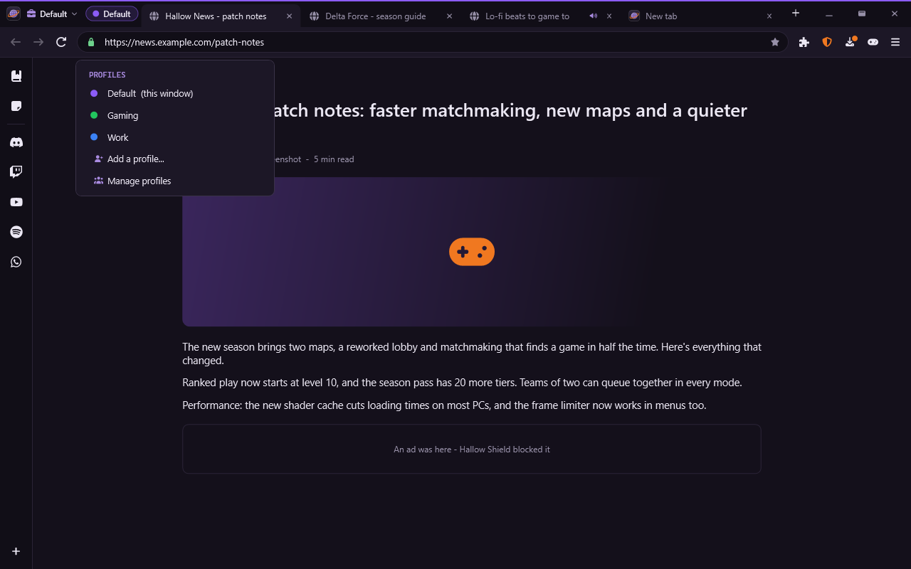

Part of the Hallow family (Mixer, Hub, Vault, Overlay, Remote, Clips, Keys, Assist, Guard, Shield, Setup, Toolkit).

## Download

Get **Hallow.Browser.zip** from the [latest release](https://github.com/Dom428/hallow-browser/releases/latest), unzip it and run
**INSTALL.bat** (no admin needed). It installs to `%LOCALAPPDATA%\Programs\Hallow Browser\HallowBrowser.exe` with Start menu and
Desktop shortcuts. Or install it from [Hallow Setup](https://github.com/Dom428/hallow-setup).

Hallow Browser **never makes itself your default browser**. It registers as a browser you *can* pick, so if you want it for links,
choose it yourself: **Settings > General > Default browser > "Make Hallow my default browser"** opens Windows' Default apps page
for Hallow Browser - click **Set default** at the top (or click HTTPS, then HTTP, then .html, and pick Hallow Browser each time).

## What's new in 1.12.1: a fix for a white Twitch player

Real use, 1.12: on a live channel the **video area sometimes showed as a plain white box** while the rest of Twitch looked normal.
Debugged against the real twitch.tv (signed out, throw-away test profiles, off-screen, about 25 loads of 10 big live channels, 6 to 30 minutes each, plus game mode, tab switching and a GPU-process crash):

- **What a white player is.** Twitch's player area is drawn by layers on top of the `<video>`: the player's overlay, extension
  iframes, and - during an ad break - Twitch's ad layers (a display-ad "squeezeback" wrapper inside the player, and now a second
  **picture-by-picture** player that Twitch prepares in the chat column, seen live). With the ad swap switched off on purpose, a real
  ad that played came out as a **95 % white** player rectangle for seconds at a time (a white ad creative under Twitch's ad layer) -
  so a white box is what an ad, or an ad frame whose content is blocked, looks like. The hide rules from 1.10 also had two broad
  selectors (`[aria-label="Advertisement"]`, `div[class*="StreamDisplayAd"]`) that would hide **the player itself** if Twitch ever wraps
  the video in such a box. And in game mode the browser set **every** tab - also the stream you're watching - to the engine's "low"
  memory target, which is meant for pages nobody sees.
- **The player is never hidden.** Each hide rule now only matches a box *without* a `<video>` in it, and a guard shows a box around the
  video again if an ad rule (or an ad filter) hid it.
- **Nothing empty sits on top of it.** Once a second, on a channel page, the browser looks at what covers the middle of the video: an
  empty ad frame (an iframe from an ad host or with no address, a box named like an ad - display ad, squeezeback, picture-by-picture,
  outstream - or an empty opaque white box) is hidden. Twitch's own overlays stay: controls, extensions, the mature-content gate, error
  screens, chat, emotes, channel points.
- **A stuck video is nudged.** If the video stops moving for ~3.5 s while it should play (not when you paused it), Twitch's player is
  paused and played, then its source is reloaded - at most 3 tries until it moves again. Each fix is logged in the page
  (`window.__hallowTwitch.events`: `guard`, `unblock`, `stall`).
- **Game mode no longer lowers the memory target of the page you're looking at** - only of pages nobody sees, and a page you switch to
  gets the normal target back at once (the same on battery saver).
- **Ads stay blocked as in 1.11 / 1.12**: 6 fresh loads of live channels with 1.12.1 on the real twitch.tv: 5 got a preroll and all 5 were swapped for Twitch's own ad-free stream (nothing covered, no ad frame shown), the video kept moving, and the watchdog never stepped in - no false alarms on real pages.
- **Honestly**: the exact white box from the screenshot did not show up in the off-screen runs with 1.12's code (Twitch only shows some ad layouts now and then, and signed-in users can get others), so the fix covers each way a white box can come about rather than one reproduced case. If it still happens, `window.__hallowTwitch.events` in that tab says what the watchdog saw.
- 1.10 - 1.12 installs get the page part without updating: it is version 3 of the `hallow-twitch.js` asset on this release.

Tests: 1.12.1 adds (unit) the version-3 script (hide rules that skip a box with the video, the guard, the watchdog's timings), which
class names count as an ad box (from the real player's markup) and which never do (player, chat, extensions, the mature gate), and the
memory-target rule; and (integration "v1121", a local fake Twitch with the real player's markup, anonymous) an empty ad frame and an
empty white box over the video hidden within seconds, Twitch's own overlays (extension iframe, mature-content gate) left alone, a hide
rule matching a box around the video not hiding the stream (and the display-ad box beside it still hidden), the guard, a stuck video
nudged at most 3 times, a paused one and a normal one left alone, and the memory target per tab with a (fake) game running.

## What's new in 1.12: ready to be your default browser

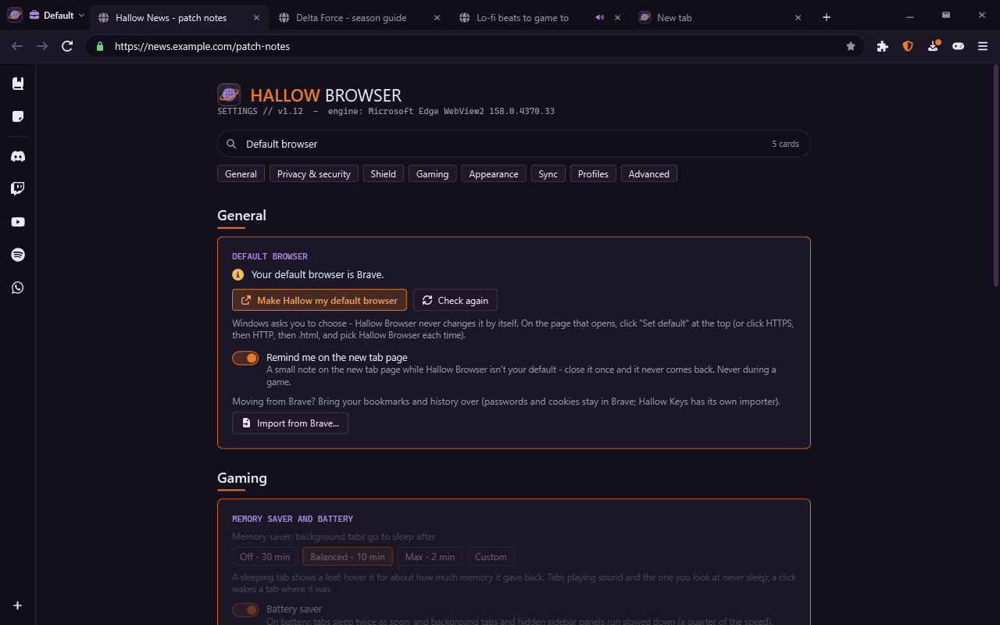

- **Registered with Windows like Chrome and Brave** - per user, no admin: a web-address ProgID (`HallowBrowserURL`) and a file
  ProgID (`HallowBrowserHTML`), each with an `Application` key (name, icon, description); `Capabilities` with URL associations
  (http, https), **file associations (.htm, .html, .shtml, .xht, .xhtml, .svg, .pdf, .webp)** and `StartMenu`; `OpenWithProgids` for
  those file types (so "Open with" lists it); `InstallInfo`; `RegisteredApplications`; then Windows is told to refresh
  (`SHChangeNotify(SHCNE_ASSOCCHANGED)`). 1.11 registered http / https only and no file types at all.
- **It still never sets itself as the default.** Windows 11 protects your choice (`UserChoice` carries a hash) - Hallow Browser
  never writes it and never tries to get around it. It only reads it, to tell you which browser is the default.
- **Settings > General > Default browser**: "Hallow Browser is your default browser" or "Your default browser is Brave" (read from
  Windows' choice - `UserChoiceLatest` on newer Windows 11, else `UserChoice` - and named: Brave, Chrome, Edge, Firefox, Opera,
  Vivaldi...; it also says when HTTP links still go elsewhere). **"Make Hallow my default browser"** opens
  `ms-settings:defaultapps?registeredAppUser=Hallow%20Browser` (Windows' Default apps page for Hallow Browser; plain Default apps if
  that fails) with one line on what to click there. **"Import from Brave..."** for moving in (bookmarks and history, as in 1.3).
- **A one-time note on the new tab page** while Hallow Browser isn't the default, with a button to the same Windows page. Close it
  once and it never comes back (Settings can turn it on again). Never shown while a game runs; nothing ever pops up.
- **Links and files open properly.** What Windows hands the browser becomes a **new tab in the window you already have open** (the
  single-instance pipe; no second window): http / https addresses, local files - turned into an exact `file:///` address
  (spaces, `#`, `%`, accents and other unicode escaped like Chromium does, network paths as `file://server/share/...`), also a path
  Windows split at its spaces - and `file:` addresses. PDFs open in WebView2's own PDF viewer, SVG and WebP as images.
  **Fixed:** 1.11 read a local path like `C:\page.html` as a search for "C:\page.html" (its "C:" looked like a scheme) and sent
  it to the search engine; anything that isn't an address or a file is now **refused, never searched**. The ProgIDs start the
  browser with `--single-argument %1` (like Chrome), so a crafted link can't smuggle in switches such as `--cmd quit`.
- **Stays registered**: at start the browser checks its registration (a few registry reads on a background thread) and
  re-registers only when something is missing, the registered exe is gone (a moved install) or this is the installed copy (an
  update) - a copy run from elsewhere never takes it over. The installer runs `HallowBrowser.exe --register`, the uninstaller
  `--unregister` (only our own entries; other browsers' stay). `--hide-icons` / `--show-icons` are Windows' InstallInfo commands.

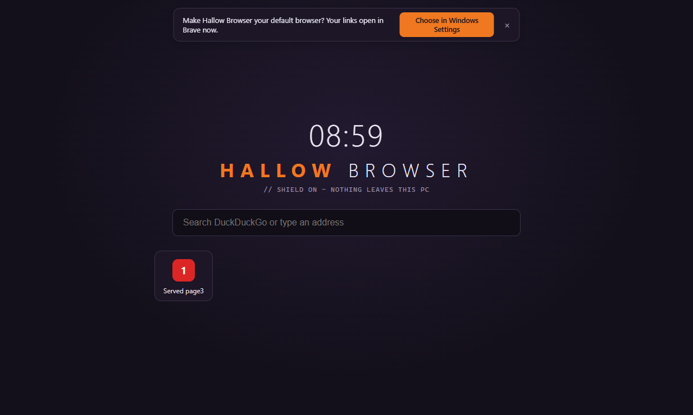

### Making it your default

1. Hallow Browser: **Settings > General > Default browser > Make Hallow my default browser** (or the note on the new tab page).
2. Windows opens **Settings > Apps > Default apps > Hallow Browser**. Click **Set default** at the top.
   If your Windows has no such button: click **HTTPS**, choose **Hallow Browser**; then **HTTP**; then **.html** (and .htm / .pdf
   if you like).
3. Back in Hallow Browser the card says "Hallow Browser is your default browser" ("Check again" if it was open).

Tests: 1.12 adds (unit) the registration written to an in-memory fake and to a sandbox key under `HKCU\Software\HallowBrowserTests`
(deleted after; the real HKCU keys and your `UserChoice` compared before / after), re-registration decisions, the status for
Brave / Chrome / Edge / Hallow / Firefox / Vivaldi / Store / unknown / none, command-line arguments (addresses, paths with spaces,
`#`, `%` and unicode, split paths, network paths, junk) and the hint's rules; and (integration "v112", off-screen) second starts with
files and links becoming tabs in the running window, `--single-argument`, PDF / SVG / WebP, junk refused, the card and the hint
(both looks) with Windows Settings never opened, and the `--register` / `--unregister` / icons commands against a sandbox key.

Needs: Windows 10/11 x64 with the **Microsoft Edge WebView2 Runtime** (Windows 11 has it). If it's missing, Hallow Browser says so and
opens Microsoft's WebView2 page when you click - it never downloads the runtime itself.

## What's new in 1.11: Twitch ad handling, fixed on the real Twitch

1.10's Twitch ad handling had only been tested against a local fake Twitch, and on the real site **an ad could still play**. 1.11 was
debugged against the real twitch.tv (signed out, a throw-away test profile, off-screen) and fixed:

- **What was wrong.** Twitch's player does fetch its playlists in a classic Web Worker (made from a `blob:` address that only
  `importScripts()` Twitch's amazon-ivs worker), and 1.10's prelude did run in it. But Twitch now asks usher for the master playlist
  at `/api/v2/channel/hls/<channel>.m3u8` and fetches the media playlists from `<cluster>.playlist.ttvnw.net/v1/playlist/...` (no
  `.m3u8` in the address). 1.10 only knew `/api/channel/hls/`, so it never learnt which channel a worker was playing. Opening a
  channel's address directly happened to work (it fell back to the page address), but **opening a stream from the front page or the
  directory** - Twitch keeps the same worker across its in-page navigation - let the ad play, unmuted and uncovered (reproduced).
- **The fix.** The channel always comes from the worker's own latest master playlist (both usher addresses), never from the page
  address, which is stale after in-page navigation (it could even have swapped in another channel's stream). Media playlists are
  recognised by the master's list or Twitch's playlist hosts. The alternative is fetched per quality.
- **Staying on the ad-free stream.** On the real Twitch, the player **stalls for good** if it is handed its own stream again after a
  swapped break (paused, buffer empty, never recovers - seen every time). So after a swap the player now **stays on Twitch's ad-free
  stream** (the same live stream at the same quality) until its next master playlist (a reload or another channel); if that stream
  gets an ad of its own, another clean one is looked for. If the video still stops after a break, Twitch's own player is nudged
  (pause / play, then a reload of its source).
- **A second signal.** When Twitch's player shows its own ad label or countdown anyway, the video is covered and muted until the label
  goes away.
- **Early enough.** A tab that opens straight onto twitch.tv now waits for the script to be registered before it loads.
- **Results on the real twitch.tv** (each load a fresh profile, so Twitch shows prerolls): 12 loads of big live channels (kaicenat, xqc, hasanabi, stableronaldo), half opened directly and half from the front page by Twitch's in-page navigation: **6 had an ad served and all 6 were skipped via the swap** (3 direct, 3 from the front page) - no ad label, nothing covered, no stall through the end of the break (pods of 30-75 s); the other 6 got no ad. With 1.10's script the front-page case played the ad (reproduced), and before the "stay on the ad-free stream" change the player stalled at the end of the break in 2 of 2 runs. Not seen on the real site in these runs: a break where every alternative had the ad, so the cover and the ad-label signal are tested only against the fake Twitch. The front-page "click" was Twitch's in-page navigation triggered from a script, not a real mouse click.
- Hallow Shield 1.7 was on (as an extension) in these runs and didn't get in the way.
- 1.10 installs get the fix without updating the browser: the fixed script (version 2) is the `hallow-twitch.js` asset on the
  release, which 1.10 checks about once a day.

## What's new in 1.10: Twitch ad handling

**Twitch ads don't play** - on by default, because that's what was asked for. Settings > Gaming > Twitch ads turns it off, and you
can **allow ads on channels you want to support**.

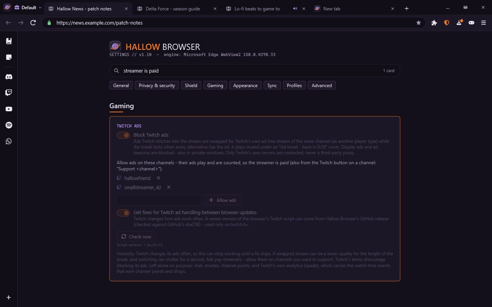

How it works:
- **Stitched ads.** Twitch puts its video ads into the stream itself (server-side ad insertion): the HLS playlists from
  `usher.ttvnw.net` get ad segments, marked with `#EXT-X-DATERANGE` tags (`CLASS="twitch-stitched-ad"`, `twitch-ad-quartile`) and
  segments titled `Amazon|...`, and Twitch's player fetches those playlists in a Web Worker. The browser runs a small script of its own
  at document start on twitch.tv pages (in the page itself - not an extension) that starts every worker with a prelude watching its
  playlist fetches. When a playlist carries ad markers, it asks **Twitch itself** for the same channel's stream as another of Twitch's
  player types - "embed", "popout", "autoplay", "picture-by-picture" - with Twitch's public PlaybackAccessToken query on
  `gql.twitch.tv` (the public web client id twitch.tv itself sends) and `usher.ttvnw.net`, and hands the player that playlist,
  at the same quality when there is one, while the break lasts. The player type that worked is tried first next time.
- **Only Twitch's own servers.** No third-party proxy (TTV LOL, Luminous and the like see every stream you watch - a privacy risk),
  and no cookies or sign-in go with these requests.
- **When every alternative has the ad too**, the ad plays **muted under a Hallow cover**: "Ad break - back in 0:28", counting down
  the length from the `DATERANGE` tag (the pod's length when Twitch gives it). The tab is muted by the browser as well, and the cover
  lifts and the sound comes back when the break is over.
- **Display ads and ad beacons.** Requests from Twitch tabs to ad hosts (Amazon's ad system, `edge.ads.twitch.tv`, Google's ad and IMA
  servers, comScore, Nielsen and a few more) are blocked by the browser itself (WebResourceRequested); the display-ad boxes and "Ad"
  labels are hidden; a GraphQL call made **only** of ad-event reports is answered in the page instead of being sent (a call that mixes
  in anything else is never touched). **Left alone on purpose:** chat, emotes, channel points, and Twitch's analytics
  (`spade.twitch.tv` - it carries the watch-time events that earn channel points and drops) and view counts (`countess.twitch.tv`).
- **The Twitch button** (on a channel, in the address bar) says what happened to the last break - **"Ad break skipped (swapped
  stream)"** or **"Ad covered"** - and has **"Support <channel>: allow ads"**. On channels in your allow list nothing is touched:
  their ads play and their beacons go, so the streamer is paid.
- **Private windows too.** Extensions don't run in WebView2's InPrivate profiles, but none of this is an extension: the page script and
  the request blocking are the browser's own.

Honestly:
- **Twitch changes this often**, and then it can stop working until a fix ships. Fixes come with the browser's normal releases, and -
  so they don't have to wait for one - the page script is a small updatable file: once a day the browser looks at its own latest GitHub
  release for a `hallow-twitch.js` asset, checks it against GitHub's sha256 and uses it only if its version line is newer than the
  built-in one (Settings > Gaming > Twitch ads > "Get fixes for Twitch ad handling between browser updates", on; "Check now").
- **A swapped stream can drop in quality for the length of the break** (the embed and popout streams usually have every quality;
  autoplay and picture-by-picture only 360p), and switching streams can stutter for a second.
- **Ads pay streamers.** That's why there's a per-channel allow list - use it for the channels you want to support.
- **Twitch's terms discourage blocking its ads.** Using this is your choice; switch it off any time.
- 1.10 was tested only against a local fake Twitch and did not work on the real site in every case - see 1.11 above.

## What's new in 1.9: speed and accessibility

**Accessibility**
- **Screen readers**: every toolbar button, tab, menu item, sidebar entry and setting has a UI Automation name, help text (the tool
  tip) and role; shortcuts are announced as accelerator keys ("New tab", Ctrl+T). Tabs are real TabItems (selectable, "playing",
  "muted" and "asleep" in their names). Tested by a UI Automation walk of the window, Settings, the sidebar and every flyout - the tree
  Narrator reads. **Narrator itself wasn't run** in the tests (it needs a real, focused desktop and speaks out loud).
- **Keyboard**: a visible focus outline; the toolbar's icon buttons are keyboard stops now (a mouse click still leaves the focus where
  it was); **F6 / Shift+F6** cycle address bar -> tabs -> page -> sidebar; on a tab, the arrow keys move, Enter shows, Delete closes,
  Shift+F10 opens its menu (also on sidebar entries); flyouts take the keyboard when opened with it, Tab cycles inside and **Esc**
  closes them and goes back to their button (no traps); in Settings Tab goes top to bottom, a section link moves the keyboard into
  that section and Enter in the search box jumps to the first match.
- **Bigger text and controls**: Settings > Appearance > Accessibility - **Like Windows** (Settings > Accessibility > Text size, the
  default) or 100 / 125 / 150 / 175 / 200 %. It scales the browser's own UI (title bar, toolbar, tab column, sidebar, menus, tool tips,
  Settings and the other built-in pages, dialogs) and never the pages: **page zoom stays separate** (Ctrl + / Ctrl -).
- **High contrast**: with a Windows contrast theme the browser uses its system colours only (window, text, highlight), lines drawn in
  the text colour, a thicker focus outline and the shown tab outlined - switched live, including controls already on screen. Pages get
  Chromium's own forced colours.
- **Reduced motion**: Windows' "Animation effects" off = no motion in the browser (it has no animations of its own beyond flyouts,
  which then open without one), and pages are told through prefers-reduced-motion.

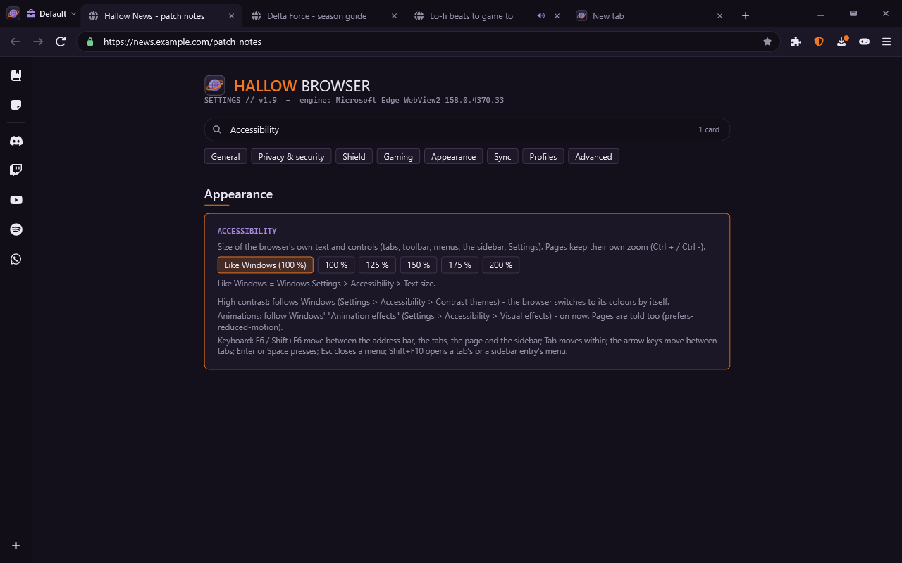

**Speed** - see [the speed table](#speed-measured-on-this-pc) for the before / after numbers.
- Start-up: the engine's preference files are written on another core while the window is built, and the theme reuses the settings
  already read; your own extensions load after the first page (Hallow Shield never waits).
- Measured and dropped (no gain): a low memory target for pages off screen, and extra game-mode measures (a sleeping pre-warmed tab,
  slowing background players) - see the speed section. Hover and taskbar previews no longer keep the encoded picture they came from.
- Site isolation is **not** weakened: the renderer cap stays at 8 and only shares processes between tabs of the same site; different
  sites always keep their own processes (fewer processes would save memory but let one site's crash or exploit reach another).
- **Benchmark** (`tests\Bench19.cs`, reusable for a Brave comparison): start-up (new profile and warm), new tab, scrolling frame times,
  memory with 14 pages on 14 sites and after 10 minutes in the background, CPU / GPU with a background video while a fake game runs.
  **Speedometer 3 isn't run**: it isn't on this PC and nothing is downloaded - for 2.0, if you agree to run it on browserbench.org.

**Fixes from real use**
- **Overlay: on / off** on the new tab page now shows Overlay's real state - asked over Overlay's pipe (its status.json can lag behind
  a toggle), on load and after each click.
- The **+** (new tab) button sits centred on the tabs (it was 2 px high).
- The **bookmarks bar** turns itself on once you have a bookmark (yours or imported) - unless you hid it (Ctrl+Shift+B), then it stays
  hidden. Installs from before with bookmarks get it once.
- **Tab groups** are easier to find: right-click a tab > **Add tab to new group** / **Add to group** (a list) / **Auto-group tabs by
  site**; Menu > **Group tabs**; Ctrl+K "Group tabs"; and a one-time tip once you have 6 tabs.
- The **game-mode chip** is now a small controller icon (tool tip "Game mode ...") shown only while game mode is on, and Settings >
  Gaming > Speed and gaming > "Show the game mode icon" hides it. Game mode also turns off properly: Hallow Hub's "playing" counts only
  while Hub runs, and never for a game (Delta Force, Discovery) whose process is gone - a status file left behind kept it on.

## What's new in 1.8: gaming extras

**Skip sponsors and intros on YouTube** (Settings > Gaming > YouTube and Twitch) - **off by default**, because it contacts
**SponsorBlock**, the free community list of sponsor segments (sponsor.ajay.app):
- For each video you open, the browser asks SponsorBlock's public API with the **privacy-preserving hash-prefix lookup**:
  `GET https://sponsor.ajay.app/api/skipSegments/<prefix>?categories=[...]&actionType=skip`, where `<prefix>` is **only the first 4
  characters of the SHA-256 of the video's id**. SponsorBlock answers for every video whose hash starts the same way (64 videos for one
  prefix in a real check) and the browser picks yours out, so SponsorBlock doesn't learn which video you watch. No address, no account,
  no cookies, no referrer - the request comes from the browser itself ("HallowBrowser/1.8"), not from the page. Answers are kept in
  memory for 30 minutes; a video you go back to isn't asked for again.
- Pick what to skip: **sponsors, intros and intermissions, outros and end cards, self-promotion, interaction reminders** (like /
  subscribe) - sponsors and self-promotion by default. **Skip automatically** (a small note says what was skipped, with **Undo**) or
  **Show a Skip button** over the video. A segment skipped once isn't skipped again by itself if you go back into it - you get the
  button instead. Works with YouTube moving from video to video without loading a new page, and in full screen.
- It's the browser's own small script on youtube.com (in its own closed shadow DOM, so the page can't restyle it), not Hallow Shield.
  If SponsorBlock can't be reached, nothing is skipped.
- **Credit and terms**: segment data from **SponsorBlock** by its contributors. SponsorBlock's API and database are licensed
  **CC BY-NC-SA 4.0** (its wiki: "The API and database follow CC BY-NC-SA 4.0 unless you have explicit permission"). Hallow Browser is
  free and non-commercial, credits SponsorBlock in Settings and here, uses the data as it comes and keeps it only in memory - it
  doesn't redistribute it. SponsorBlock's API rules (no automated submissions) don't apply: the browser only reads, never submits.
- Tested only against a local stand-in SponsorBlock server and a YouTube-like test page with a real `<video>`. The real API was called
  once, by hand, read-only, to check the answer's format (an array of `{videoID, segments: [{category, actionType, segment, ...}]}`).

**Twitch extras**:
- **Chat in the sidebar** (optional, off by default): watching a channel (`twitch.tv/<channel>`) opens its pop-out chat
  (`https://www.twitch.tv/popout/<channel>/chat`) in a sidebar panel of its own - signed in like your tabs, not added to your sidebar
  sites. It **stays beside the stream in full screen** (Twitch's full-screen button: the stream fills the window, the chat beside it)
  **and in theatre mode**; another tab or leaving the channel closes it, another channel switches it; close it with its X and it stays
  closed for that channel.
- **Theatre mode**: the **TV button** in the address bar on a stream (or **Alt+Shift+T**, or Ctrl+K) hides the browser around the page -
  the tab strip, toolbar, bookmarks bar, vertical tabs and the sidebar's rail - and on Twitch also turns on **Twitch's own theatre mode**
  (its player button, turned off again when you leave). **Esc** leaves. Full screen from theatre mode comes back to theatre mode.
- **Auto-claim channel points: not built.** Twitch's Terms of Service (*Prohibited Conduct*) forbid accessing Twitch's services "by
  means of any robot, spider, scraper, crawler, or other automated means for any purpose". A script clicking the bonus for you is
  automation of exactly that kind, so the browser never clicks it (tested: the bonus button on the test page is never clicked).

**Clip it - the last 30 seconds of a stream into Hallow Clips**: the **clapperboard button** in the address bar on a stream (a Twitch
channel or a YouTube video - shown when Hallow Clips is installed; also in Ctrl+K) asks Hallow Clips over its family pipe
(`HallowFamily.Clips.<user>`) to `save` its replay buffer and shows **"Clip saved (the last 30 s): <file>"** with the file from Clips'
reply. Clips records **your screen**, so:
- the stream has to be on screen (the active tab of a window that isn't minimised, or a popped-out video) - otherwise the browser
  says so and asks nothing;
- if Clips isn't running, isn't recording (by default it records only while a game runs - turn off *Only while a game is running* in
  Clips' settings to clip streams), or is paused for Discord Clips, the browser explains that instead. Clips' own errors ("Nothing
  recorded yet") are passed on. The browser doesn't record anything itself; the length is Clips' clip length (30 s by default).

**Game launch handoff**: **Play** on the new tab page's **Your games** row turns **game mode on at once** (background tabs sleep,
lower priority) instead of waiting for the next look. It turns off when the game closes - told by **Steam's own running flag** for that
game (`HKCU\Software\Valve\Steam\Apps\<id>\Running`, read only), **Hallow Hub's playing state** or the game's process - or after
**2 minutes** if the game never showed up. Hub's playing state still turns game mode on by itself, as before. Tested with launch links
written to a log and Steam's flag from a test file: no game was started.

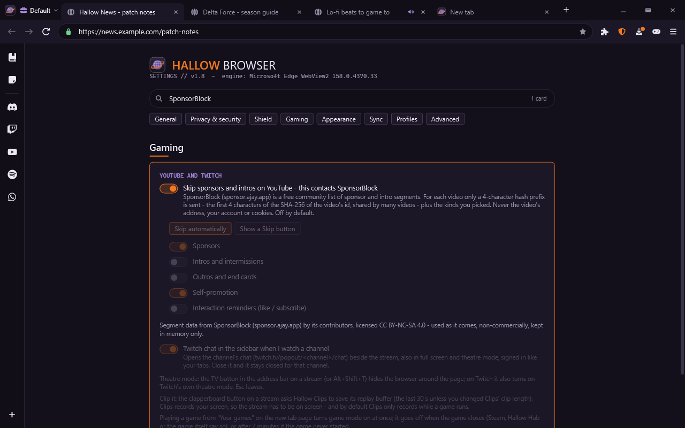

## What's new in 1.7: translate pages, a cleaner Settings, taskbar extras, more sync

**Translate pages** (Settings > General > Translate pages) - **off until you pick a service, and nothing is preset**:
- **Your own LibreTranslate server** (any LibreTranslate-compatible address you enter - e.g. one on your NAS), or **DeepL** or
  **Google Cloud Translation with your own API key**. Keys are kept on this PC only, protected by Windows (DPAPI, your user:
  `translate-keys.bin`) - never in settings.json, never in sync. Hallow has no translation server of its own.
- Once a service is set up, a **translate button** shows in the address bar. Its panel says exactly **what is sent: the text of the
  page, to the service you picked** - not the address, not cookies, not form fields - and nothing goes out until you click
  **Translate** (tested: setting a service up sends nothing; the request carries no page address, cookie or referrer).
- The page's text nodes are translated **in batches** (at most 50 texts / ~4,500 characters per request; the first 3,000 pieces of a
  very long page); code, `<pre>`, form fields, scripts, editable areas and anything marked `translate="no"` / `notranslate` are left
  alone. **Show original** puts every text back exactly (spaces included). The browser makes the requests itself, so the key never
  enters the page.
- **Always translate <language>** (in the button's panel): pages in that language are translated as they load - only those (tested:
  a French page is, an English page sends nothing), never in private windows by themselves.
- Honestly: text a page adds after you translated stays as it is until you translate again.
- Tested against local stand-ins only (a fake LibreTranslate server, fake DeepL and Google endpoints): the exact request each service
  gets (DeepL: `Authorization: DeepL-Auth-Key`, Free keys to api-free.deepl.com; Google: `X-Goog-Api-Key`, never in the address), a
  refused key changes nothing and says so. The real services were never called.

**Cast** - checked, and **WebView2 can't**: it has Chromium's Presentation API (`navigator.presentation`, `PresentationRequest`) but
no Media Router behind it - measured: `getAvailability()` answers false and `start()` (with a click) fails with "NotFoundError: No
screens found"; there's no `chrome.cast` and no Cast dialog. So there's no DLNA / Cast stack of our own; instead **"Open in Edge to
cast"** (menu, Ctrl+K, Settings > General > Cast to a TV) opens the current tab in **Microsoft Edge** (`microsoft-edge:<address>`),
whose menu has *Cast media to device*. Your Hallow sign-ins aren't in Edge.

**A cleaner Settings page** - the cards are grouped into **General, Privacy & security, Shield, Gaming, Appearance, Sync, Profiles and
Advanced**, with a row of section links at the top, and a **search box**: type and only the matching cards stay (inside a card the
matching switches stay bright), **Enter jumps** to the first match. **Ctrl+K finds settings too** - every card and every switch or
choice, e.g. "cookies" -> *Block third-party cookies (Settings > Privacy & security > Privacy)*; picking one opens Settings right there.
Changing a setting keeps your search and where you were.

**Taskbar extras** (Settings > Appearance > Taskbar):
- A **jump list** on the taskbar and Start icon: **New tab, New private window, Reading list** and **each of your profiles** (Windows'
  `ICustomDestinationList` through COM - no libraries). The items start `HallowBrowser.exe --jump new-tab` (or `--profile <id>`); a
  running browser gets them through its pipe. Tested on a **test AppUserModelID** (written, found in Windows' list file, deleted) so
  your real jump list was never touched; an unknown `--jump` value opens nothing.
- **Each tab in the taskbar preview** (**off by default**): every tab gets a hidden stand-in window registered with
  `ITaskbarList3::RegisterTab`; Windows asks it for a picture (DWM iconic thumbnails from the tab's own preview), a click switches to
  that tab, its X closes it. Tested by sending the stand-ins Windows' own messages (RegisterTab and DwmSetIconicThumbnail answer S_OK,
  activate / close work). Honestly: the hover row itself is drawn by Windows' taskbar and wasn't looked at (that would mean using your
  screen), and with many tabs the row gets long.

**More sync** (Settings > Sync):
- **Hallow Shield's My filters**: Shield keeps them in its own storage; since 1.4 the browser runs its own copy of Shield, so it reads
  and writes My filters **through a hidden page of Shield's own origin** (like the family relay) - Shield's background sees the change
  and recompiles them, as when you edit them in Shield (tested: written, read back, compiled by Shield, and synced into a second test
  profile's Shield). The newer change wins; a PC that can't reach Shield sends nothing for them (never an empty list over yours).
- **History, opt-in and encrypted only**: it needs the sync password (AES-256-GCM in the folder); without one, history is never
  written there - not even other PCs'. A **size cap** (the newest 250 / 1,000 / 2,500 / 5,000 pages, default 1,000). Pages from your
  other PCs are merged in (most visits, newest visit); a page pushed out by the cap, or clearing history on one PC, deletes nothing
  on the others (no delete markers for history). Tested between two test PCs and two test profiles: encrypted file, the page arrives.

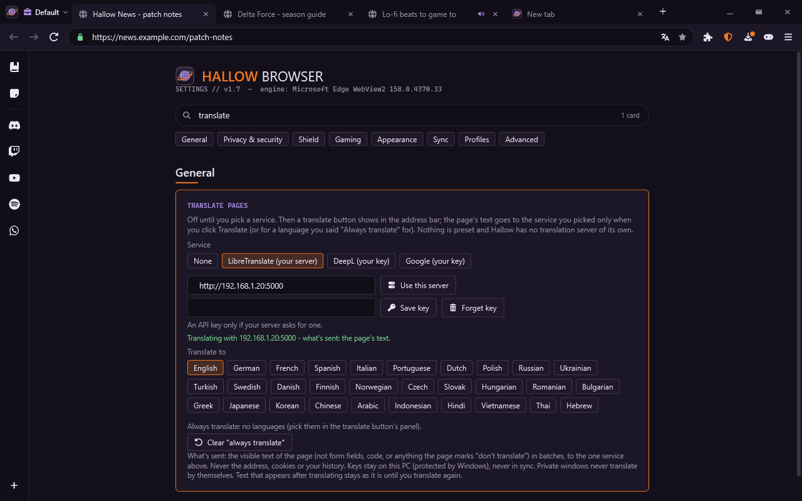

## What's new in 1.6: profiles, your Hallow apps on the new tab, sites as apps

**Profiles** - e.g. "Personal" and "Gaming", each with its **own sign-ins and cookies, history, bookmarks, sidebar panels, settings,
sync and private windows**.
- The **profile button** in the title bar (its colour and name, shown once you have more than one profile; the window's top edge
  takes the profile's colour too) switches or adds profiles; Settings > Profiles adds, recolours, picks the one a plain start opens,
  and removes one from the list (its files stay until you delete them). **Right-click a link > Open link in profile**.
- Each profile is its own **WebView2 profile** (`CoreWebView2ControllerOptions.ProfileName`, e.g. `Hallow_gaming`) in the one engine
  folder, run by its **own Hallow Browser process** (`HallowBrowser.exe --profile gaming`) - tested: both run on the same engine (one
  browser process), a cookie set in Default isn't in Gaming, Gaming's private window is its own InPrivate profile
  (`HallowPrivate_gaming`), its history and files are in `Profiles\gaming`.
- **Shield is loaded in every profile** (tested in Default and Gaming). **Sync per profile**: Default syncs in the folder you picked,
  as before; another profile in a `profile-<id>` sub-folder of it (tested), so profiles never mix.
- **Your data from before 1.6 is the "Default" profile, with no loss**: nothing is moved or rewritten - Default keeps 1.5's folders and
  the engine's default WebView2 profile (your sign-ins). On the first 1.6 start a copy of the settings files goes to
  `%APPDATA%\HallowBrowser\backup-1.5`. The migration test builds a fake 1.5 folder (settings, tabs, workspaces, bookmarks, the engine's
  profile and cookies, history, Shield), migrates it and compares every file: all unchanged, settings and tabs load as before; the
  integration test starts 1.6 on a fake 1.5 folder and gets the tabs and settings back.
- Honestly: secure DNS and the spell check language are engine-wide (one setting for every profile - set in Default). Hallow apps talk
  to the Default profile (`HallowFamily.Browser.<user>`); another profile answers on its own pipe (`Browser-<id>`), and the Default's
  `menu` offers "Open profile: ..." for Hub's tray menu.

**The Hallow family on the new tab page** (Settings > Hallow apps on the new tab page) - everything local, each row only when that app
is installed:
- **Your games** from Hallow Hub's library (hub.json, read only; with Hub's own screenshot of each). **Play** asks Hub first; Hub 2.16
  has no launch command on its pipe (checked: it answers "unknown command"), so the browser then opens the game's own launch link
  `steam://rungameid/<id>` - only when you click (tests write it to a log; no game is ever started).
- **Recent clips** from Hallow Clips' status.json, with their thumbnails; a click opens the clip.
- **Hallow Overlay on / off** through Overlay's `toggle` pipe command, showing its state from its status.json.
- **Lazy**: the page draws first; family.json is fetched only once the engine reports the page's first paint (measured in the test).

**Install this site** (menu) - its own **app window** (no tabs or address bar; the site's name and icon, back / reload / open in the
browser), a **Start menu shortcut** (Start > Hallow Browser Apps: `HallowBrowser.exe --app <url> --profile <id>`) and
**hallow://apps** with Open and Uninstall.
- Name, start address, scope and icon from the page's **web app manifest** when it has one (read by the page itself; the biggest
  PNG/ICO/JPG icon - SVG icons can't be drawn by WPF, so then the favicon); without one, the page's title and the **favicon the engine
  already has** (`GetFaviconAsync` - no extra fetch). The shortcut gets a real .ico (256 px PNG + 48/32/16 px bitmaps).
- Links you click to another site open in the browser; sign-in redirects and links inside the app's scope stay in its window.
- Honestly: app windows share Hallow Browser's taskbar button (same program).

**Spell check** - misspelled words are underlined and right-click shows suggestions, plus **"Add to dictionary"** (the browser's own
menu item - WebView2's menu has none). Measured: WebView2 checks with **Windows' own spell checker**; it **ignores Chromium's
`spellcheck.dictionaries` preference** (tried, like the 1.4 DoH approach - no effect), so the **language is the engine's language**
(Settings > Spell check offers the languages Windows has spelling for - here en-US, en-CA, en-LR, en-PH; picking one also changes the
language pages are asked for and the menu's language, after a restart). Nothing is downloaded by the browser; more languages come from
Windows Settings > Language (Windows gets them from Microsoft). "Add to dictionary" writes the word to the profile's own `Custom
Dictionary.txt` before the engine starts: **it applies from the next start** (tested: after a restart the word is accepted while
another misspelling is still flagged). Turning spell check off stops it in new pages.

**Memory saver** Off / Balanced / Max - background tabs sleep after **30 / 10 / 2 minutes** (1.5's own "sleep after" stays as Custom).
A sleeping tab shows a **leaf** with **"about N MB saved"** (its page process measured before and after it slept - an estimate when
pages share a process).
- **Battery saver** (on): on battery tabs sleep **twice as soon**, and background tabs and hidden panels are **slowed to a quarter of
  their speed** (DevTools CPU throttling; tested: 4-5x fewer script loops). Honestly: a hidden tab already draws no frames in Chromium and
  WebView2 has no frame-rate setting, so slowing their scripts and timers is what it can do.
- **Startup boost** (**off by default**): when the last window closes the browser's own process stays, hidden, at idle priority,
  memory trimmed. It **uses some memory while closed** - measured about 10-12 MB in use (~125 MB committed, which Windows keeps
  paged out). The engine itself isn't kept (WebView2 ends its browser process with the last page), so on the next start the window is
  drawn about 130 ms after the request and the pages follow as the engine starts.

**Sounds and ambience** (**off by default**): a soft blip when a tab opens or closes, a chime when a download is done, a cue when game
mode turns on, and a calm 12-second ambience loop - all **synthesised when the browser is built** (`tools\gen-sounds.ps1`: sine tones
with envelopes, nothing recorded or downloaded). A volume slider for each; **while a game runs everything is quiet** (only the short
game-mode cue as it starts; the ambience pauses).

**Reading list and notes** (two panels at the top of the sidebar): **Save for later (Ctrl+Shift+D)**, read / unread, remove; and a
**short note per page** (saved as you type, shown for the page you're on, with a list of all notes). Both stay on this PC
(`reading-list.json`, `notes.json` in the profile's folder); **notes go through the 1.3 folder sync** when it's on - **encrypted when the
sync password is set** (tested between two test PCs and in the browser: the note isn't readable in the sync file).

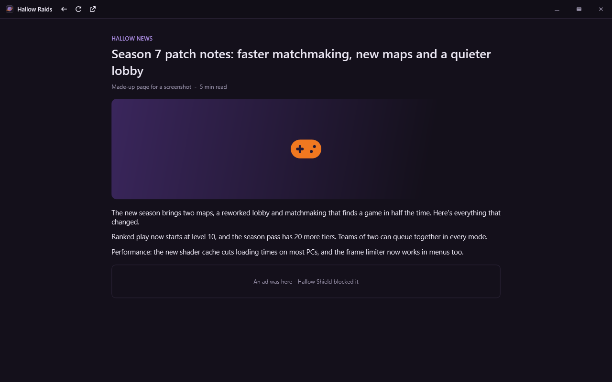
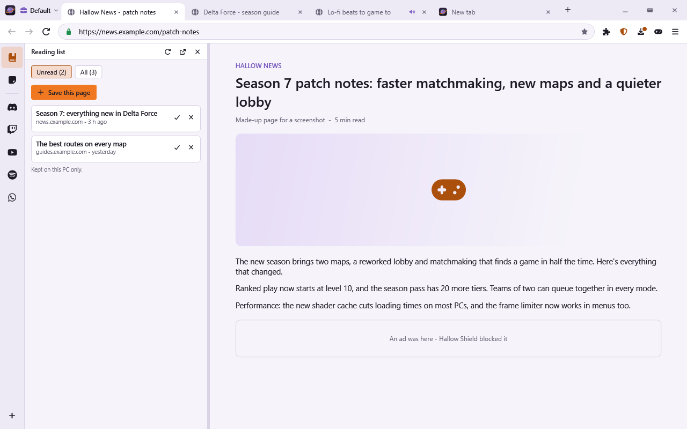

## What's new in 1.5: faster to use, safer downloads, logins into Keys

**Save logins to Hallow Keys**
- After you sign in, **"Save to Hallow Keys?"** under the address bar - **Save** (or **Update** for a changed password), **Never for
  this site**, **Not now**. A small script of the browser's own (top frame only) notices a login form being sent - a real submit,
  a real click on its button or Enter in a box (`isTrusted` events only) - and hands the username and password to the browser.
- The hand-off uses **Keys' own, documented native-host protocol** - the same two requests Keys' browser extension makes since Keys
  1.1 ("offers to save new logins"): `save-check` (Keys answers new / update / same) and, only after your click, `save`. Hallow Keys
  wasn't changed. The same checks as the extension: the address sent to Keys is the address of the top-level document that sent the
  form, as the engine reports it (a page can't change its origin; frames' messages never reach this handler - tested with a
  cross-origin frame), Keys decides itself whether it's new, and nothing is saved without your click.
- **The browser never stores passwords**: the password is held in memory only while the question is open (at most 3 minutes, or until
  you answer or close the tab), kept out of crash reports, never logged, written or synced. Tested: no test password in any of the
  browser's files afterwards. Not offered in **private windows** (the script isn't even there). Turn it off, or see the "never"
  sites, in Settings > Hallow Keys.
- Honestly: the page's own scripts could fake a "sent" form - all a page can do with that is offer to save a login for its own site,
  which you can refuse.

**Address bar**
- **Calculator and conversions**: `200*1.2`, `2^10`, `80*15%`, `sqrt(16)+1`, `5 km in miles`, `72 f to c`, `3 gb in mib`, `60 mph to
  km/h`, `90 min in hours`... the answer is the first row under the bar (click it to copy). Worked out on this PC.
- **Search keywords**: `yt cats` (YouTube), `w term` (Wikipedia), `gh repo` (GitHub) - add your own in Settings > Address bar (a
  keyword, a name and a search address with `%s`).
- **Tab search**: `% name` lists your open tabs (every window) whose title or address matches; Enter switches to the first.
- **Search suggestions** from the engine you picked (DuckDuckGo, Google, Bing or Brave's own suggestion address) - **off by default**
  with a clear switch, because it sends what you type to the engine. Addresses, sums and tab searches are never sent; private windows
  never send anything. Tests use a local stand-in only.

**Dark pages** - "Make pages dark" (menu, Settings > Look) for every site, and per site (padlock > Dark pages, or the menu's "Make
*site* dark"). **Which approach:** Chromium's own automatic dark mode, switched on per tab through DevTools
(`Emulation.setAutoDarkModeOverride`). Measured on runtime 158: a white test page goes from brightness 255 to 18 at once, it stays
dark through reloads and same- and cross-site navigations, and `{}` turns it off again. The `--enable-features=WebContentsForceDark`
flag (and `--blink-settings=forceDarkModeEnabled=true`) work too, but only for the whole engine and only after a restart - so no CSS
invert filter was needed.

**Downloads**
- **Pause, resume and cancel** in the downloads flyout and on the new **downloads page** (`hallow://downloads`, Ctrl+J > All
  downloads): every download with its folder, **Show in folder**, Open, Remove from the list. File names, folders and sizes only
  (never addresses), in `%APPDATA%\HallowBrowser\downloads.json`; private windows' downloads aren't listed; Clear browsing data clears it.
- **Microsoft Defender checks every finished download** (Settings > Downloads, on by default): Hallow Guard 1.x's pipe can only start a
  quick scan (`scan quick`), so the browser runs Defender's own `MpCmdRun.exe -Scan -ScanType 3 -File "<file>"` from the newest
  Defender platform folder, at **Idle** priority, and shows **Defender: clean** or **Defender: threat found** (with Defender's name for
  it; Defender quarantines it as its settings say). Tests use a stand-in only - never a real scan.
- **A speed limit while you play** (Settings > Downloads: no limit, 256 KB/s, 1 MB/s, 4 MB/s or pause them). **Honestly:** WebView2 has
  no per-download throttle, and DevTools network emulation only slows downloads that start as a page navigation (measured: a link with
  `download` wasn't slowed at all). So the browser **pauses and resumes each download many times a second** to hold the speed
  (pausing stops reading from the connection, so the sender slows too). Measured: exactly 1,048,576 bytes in 4 s at 256 KB/s in a
  bare probe; in the browser test (a stand-in server sending ~2 MB/s) about 470 KB/s over 10 s at the 256 KB/s setting - it's bursty,
  because data already on its way when a pause lands still arrives, and it evens out the longer it runs. All downloads in a window
  share the limit; it doesn't cover other apps or the game's own updates. Game mode also no longer puts a tab to sleep while its
  download runs (measured: a sleeping tab stalls the downloads it started).

**Tabs**
- **Hover previews**: hover a tab for a small picture of it (taken with `CapturePreviewAsync` while the tab is on screen - after you
  switch to it and after it loads, never while a game runs - kept 240 px wide in memory only) with its title and site.
- **A drag picture** follows the mouse while you tear a tab off (1.4's leftover), and **private windows' flyouts** (menus, the
  downloads list, previews) now use the private palette (they weren't part of the window's look before).
- **Mouse gestures** (Settings, **off by default**): hold the right button on a page and drag - left = back, right = forward, down then
  right = close the tab. The page's menu stays shut after a gesture. Tested through DevTools input into the off-screen page.
- **Reopen closed window** (menu, Ctrl+K): the last 5 windows you closed (not the last one - that quits), in memory.

**Media**
- A **music button** in the toolbar when any tab (any window) plays audio or video: each one with its title (from the page's media
  session), **play / pause**, **next** (the page's own next-track handler) and mute; click a row to go to the tab. Silent and muted
  videos count too.
- **Pop out a playing video when I switch tabs** (optional, off by default): it plays on in 1.0's always-on-top pop-out and comes back
  when you return to the tab.
- **Windows' media controls**: verified - WebView2 registers each playing page with Windows' media session by itself (a test page showed
  up with its title and artist, "Playing"), so the volume flyout, Hallow Mixer and Overlay see it. **But** it appears under the
  engine's name (`msedgewebview2.exe`), not Hallow Browser's - WebView2 has no way to change that.

**Crash recovery**
- A tab whose page process crashes shows **"This tab crashed - Reload"** (or "stopped responding") instead of a dead page or reloading
  by itself; the other tabs are fine. Tested with DevTools `Page.crash`.
- If the **browser itself** didn't close properly (a crash, or it was killed), the next start says so; with session restore on your
  tabs are back as usual, with it off you get **Restore your tabs** (the tabs - and other windows - from then, asleep until clicked).

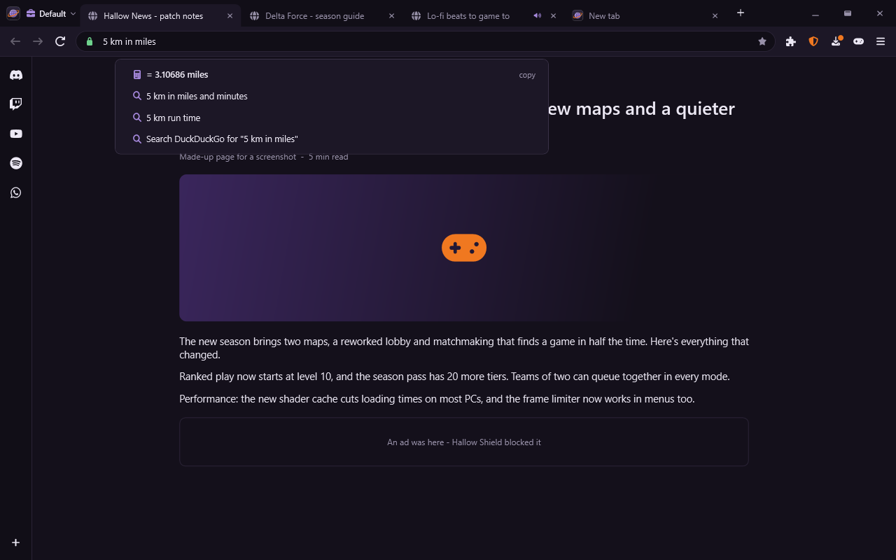

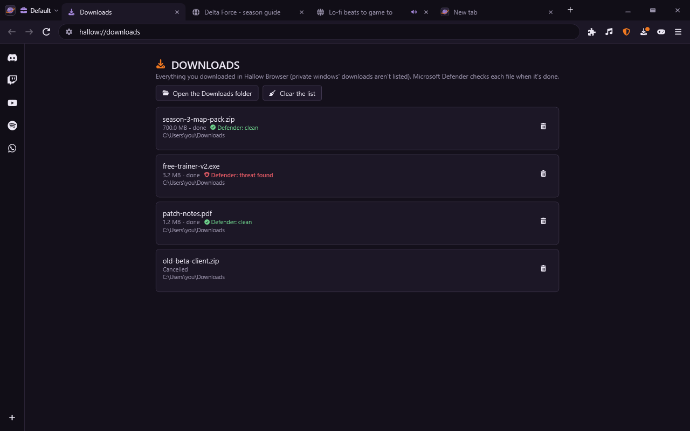

## What's new in 1.4: windows, privacy and your own extensions

**More than one window**
- **Ctrl+N** opens a new window (menu > New window). **Drag a tab out of the strip** to give it its own window where you let go, or
  **into another window's strip** to move it there - the page moves as it is (it isn't reloaded: the same WebView goes along).
- Each window keeps **its own tabs, groups and split view** in the session and comes back next time. A new window gets its own
  workspace ("Window 2"); the workspace switcher shows which workspaces are open in another window, and switching to one that's open
  elsewhere brings that window forward. Closing a window (not the last) closes its tabs - and its "Window n" workspace, unless you
  switched it to another workspace first. **Closing the last window quits**; menu > Exit closes every window and keeps them all for
  next time.
- Sync, live notifications and Shield's relay run once, in the first window (the next one takes over if you close it).

**Private windows** (Ctrl+Shift+N, menu > New private window)
- A separate WebView2 profile with **InPrivate mode** (`CoreWebView2ControllerOptions.IsInPrivateModeEnabled`): its cookies, cache
  and site data are thrown away when the last private window closes, and pages there don't see your normal sign-ins.
- **Nothing is written**: no history (Ctrl+K's history, the address bar's typed list), no session or workspace, no bookmark, bookmarks
  bar, new-tab-page or sync changes (the star and the bar are hidden there). **Downloads are still kept** in your Downloads folder.
- Its own look: **dark purple** whatever the light / dark mode, a **mask** and a PRIVATE chip in the title bar, and its own new tab
  page. The sidebar isn't there (its panels are signed in on your normal profile).
- **Shield in private windows:** WebView2 lets Shield be *added* to an InPrivate profile, but it **doesn't run there** (tested: the
  test ad request went through; Chromium runs extensions in private windows only when they're "allowed in InPrivate", and WebView2 has
  no switch for that). So private windows get **Shield's network-only fallback** - its ~7,100 block rules through
  `WebResourceRequested` (no cosmetic filtering, no per-site settings). Tested: the test ad request is blocked there.

**Site permissions and site settings**
- The engine's permission requests come to a **Hallow prompt** under the address bar - "*site* wants to use your camera" - with
  **Allow** (saved), **Allow this time** and **Block** (saved): camera, microphone, location, notifications, clipboard, MIDI devices,
  motion sensors, window placement, local fonts, files and several downloads at once (`PermissionRequested` with a deferral; the
  answer is saved in the profile with `SavesInProfile`, so WebView2 doesn't ask again). Autoplay and storage keep the engine's default.
- **Site settings** (`hallow://settings/sites`, menu > Site settings): every site with settings of its own - its permissions
  (Allow / Block / Ask, from `GetNonDefaultPermissionSettingsAsync`, changed with `SetPermissionStateAsync`), **pop-ups** (blocked unless
  you clicked - like other browsers - or Allow / Block), **sound** (Mute), **JavaScript** (Block: `IsScriptEnabled` off for that site's
  pages), insecure http allowed, and **cookies** (count, Delete). **Reset** per site.
- The **padlock** in the address bar is a button now: the connection (https or not) and the current site's settings.
- Honestly: WebView2 has no per-site cookie *blocking* - the browser can delete a site's cookies, and third-party cookies stay blocked
  everywhere (Settings > Privacy).

**HTTPS-only mode and secure DNS** (Settings > Security)
- **HTTPS-only** (on by default): an `http://` address (port 80) is opened as `https://` first. If the secure version doesn't answer,
  has a bad certificate or sends you back to http, a Hallow page says **"This site doesn't support a secure connection"** with **Go
  back**, **Continue to the site (not secure)** (until the browser restarts) and **Always allow this site** (listed in Site settings).
  Nothing is sent over http before you agree. Local names and IP addresses (localhost, `router`, `nas.local`, `192.168.x.x`, LAN game
  servers) are left alone, like other browsers do.
- **Secure DNS** (DNS over HTTPS): **Cloudflare, Quad9, Google** or Off. **A change needs a browser restart** (Settings says so).
  How: Chromium keeps this in the engine's `Local State` (`dns_over_https.mode = secure` + the provider's template), which the runtime
  reads when it starts - the browser writes it before the engine starts. **Tested for real** with a local DoH stand-in: a name only
  the stand-in knows opened, every lookup went there (Microsoft's own background lookups too), and a name it didn't know didn't open -
  no quiet fallback to Windows' DNS. The feature-flag route (`--enable-features=DnsOverHttps:...` in `AdditionalBrowserArguments`)
  did **nothing** on its own in WebView2 158, so it isn't used. In secure mode, if the provider can't be reached, pages don't load.

**Your own extensions** (`hallow://extensions`, menu > Extensions)
- **Load unpacked...**: pick an extension's folder (the one with `manifest.json`). It's copied into the browser's data
  (`%LOCALAPPDATA%\HallowBrowser\Extensions`) and loaded with `AddBrowserExtensionAsync`; **switch it on / off** (`EnableAsync`) or
  **Remove** it (the browser's copy is deleted, never your folder). Loading a newer folder of the same extension replaces it.
- Their buttons are under the **puzzle piece** in the toolbar (an overflow menu); a popup opens in a flyout like Shield's.
- **Hallow Shield stays built in** - listed as "Built in", it can't be removed.
- **Chrome Web Store installs aren't possible in WebView2** (Microsoft's engine has no store support). Instead: get the extension's
  source or release zip from its developer (many publish one on GitHub), unzip it and Load unpacked. Updates don't come by
  themselves - load the newer folder. Some extension APIs are missing in WebView2 (native messaging, permission prompts), and
  extensions don't run in private windows.

**Shield: "blocked on this page" and the Hallow family counts**
- WebView2 has **no API to grant an extension an optional permission**, and Shield asking for it itself (`chrome.permissions.request`,
  from its popup, with a click) **never gets an answer** in WebView2 (tested: no prompt, the promise just waits). So the browser loads
  **its own copy of Shield** (`%LOCALAPPDATA%\HallowBrowser\ShieldLoaded\<version>`, made once per Shield version) in which
  `declarativeNetRequestFeedback` is a *required* permission. Same extension id (the manifest's key), and it's added **over** the
  installed Shield, which keeps Shield's settings, filters and stats (tested; 1.3 removed and re-added it on Shield updates, which
  lost them). Now the popup shows **"N ads and trackers blocked on this page"** (`getMatchedRules` for that tab) and Shield keeps its
  blocked counts (Stats).
- **Family bridge without native messaging:** every 5 minutes the browser opens a page of Shield's own origin (its `family.js`, never
  shown), which reads Shield's stats and builds the report with **Shield's own `familyReport()`** - `blockedToday, blockedWeek,
  bannersToday, level, version, browser, profile, day`, never a site - and merges it into **`%APPDATA%\HallowShield\status.json`** in
  the bridge's format (same mutex, atomic replace), **keeping the other browsers' entries** (ours is "Hallow Browser"). Hallow Hub and
  Remote show it like Shield's counts from Chrome. Settings > Hallow Shield > "Share Shield's counts with Hallow Hub and Remote" (on;
  local only).

**Game corner** (new tab page - **off by default**, Settings > Game corner: "this contacts Steam and Epic")
- **News** for the games in your **Hallow Hub library** (Hub's `hub.json`, read only: the Steam app ids of the games you last played,
  hidden ones left out) through Steam's public news API (`ISteamNews/GetNewsForApp/v2`, 3 items each, no key), and **Epic's free
  games** (now and next) from its public promotions list.
- Fetched **at most every 6 hours** (an hour after a failed try), **never while a game runs**, kept in
  `%LOCALAPPDATA%\HallowBrowser\gamecorner.json`. The new tab page shows text and links only, from that local copy - no pictures or
  scripts from Steam or Epic. See [Privacy](#privacy-what-leaves-your-pc).
- On this PC, Epic's endpoint didn't resolve (the DNS in use answers "no such domain" for it), so the free-games half was only
  checked against a stand-in in Epic's response format; Steam's format was checked once against the real API (read-only).


## What's new in 1.3: moving in and syncing

**Import from another browser** (Bookmarks manager > Import from a browser..., the menu, or Ctrl+K)
- Finds **Chrome, Edge, Brave, Opera, Opera GX, Vivaldi and Firefox** profiles on this PC and lists them with their counts
  (bookmarks, pages of history). Tick bookmarks and/or history per profile and click Import.
- **Read-only**: the files are copied to a temp folder first (browsers keep them open) and read there; the copies are deleted
  afterwards. Hallow Browser never writes to another browser's profile.
- Bookmarks go into an **"Imported from Chrome"** (etc.) folder under Other bookmarks, with the other browser's folders kept inside.
  **No duplicates**: a page you already have bookmarked anywhere is skipped, so importing twice adds nothing.
- History joins the pages Ctrl+K finds (most visits and the newest visit are kept for a page you already had; at most 5,000 pages).
- **Passwords and cookies are never imported.** Passwords belong in Hallow Keys, which has its own importer.
- How, with nothing downloaded and no SQLite library: Chromium's `Bookmarks` is JSON; Chromium's `History` and Firefox's
  `places.sqlite` are SQLite files, read by a small **read-only SQLite reader** written for this (b-tree pages, overflow pages,
  records, and the `-wal` file next to it, checksums checked - so recent visits are there even while the browser runs). Firefox
  bookmarks come from its newest `bookmarkbackups\*.jsonlz4` (Mozilla's LZ4 format, decompressed by our own LZ4 decoder). Any
  browser's exported bookmarks HTML file works too.

**Bookmarks manager** (`hallow://bookmarks`, Ctrl+Shift+O, or the menu)
- Folders on the left (Bookmarks bar, Other bookmarks and everything inside), the folder's bookmarks on the right, a search box.
- **New folder**, **rename / edit the address** (the pencil or right-click), **delete** (a folder goes with what's in it),
  **drag to reorder** or drag onto a folder (in the list or on the left).
- **Export HTML file** / **Import HTML file** - the Netscape bookmark format every browser reads and writes.
- **Bookmarks bar** (Ctrl+Shift+B, off by default): under the address bar; folders open as a list, drag to reorder, right-click for
  edit / delete / new folder, a >> list for what doesn't fit. Ctrl+D adds the page to the end of the bar. 1.2's bookmarks are on it.

**Sync through a folder you choose** (Settings > Sync, **off by default**) - OneDrive, Dropbox, a Syncthing folder or a NAS share
- Syncs **bookmarks and folders, saved sessions, workspaces** (the one you're in keeps its open tabs), **settings** (not window places
  or per-PC choices like the RAM and CPU limiters) and **sidebar panels**. The same model as Hallow Keys 2.0's sync, simplified:
  every item has a version vector; an item changed on two PCs keeps the newer change, and a bookmark or saved session changed on
  both is kept twice - the other one as "(conflict copy from PC-NAME)", the same on every PC; an edit wins over a delete it hadn't
  seen; cloud clients' conflict files ("... (1).hbsync", Dropbox's "conflicted copy", Syncthing's ".sync-conflict-") are merged in
  and moved out of the folder (kept in `sync-merged`). A PC joining a folder takes the folder's settings.
- **Optional encryption** (recommended for cloud folders - Settings says so when the folder looks like OneDrive / Dropbox / Google
  Drive): a sync password -> PBKDF2-SHA256 (600,000 rounds) -> AES-256-GCM, like Hallow Keys. Without it the file can't be read.
  The password is kept on this PC only, protected by Windows (DPAPI).
- **Not synced**: history (it stays on this PC), cookies, passwords (Hallow Keys syncs its own). Hallow Shield's My filters live inside
  Shield (the extension), not in the browser - use Export / Import in Shield's settings.

**New tab page**
- **Speed dial**: your most visited pages (from this PC's history - imported history counts) and pages you **pin** (the star on a
  tile, or Ctrl+K > Pin this page); the x takes a tile off. A **search box**, an optional **clock**, and the **Hallow strip**: Guard's
  score, what Shield blocked today and what's playing, from the other Hallow apps' status files. All local - nothing is loaded from
  the network.
- **Fixed**: on current WebView2 runtimes 1.2's new tab page showed an error page ("can't reach this page"): the runtime no longer
  serves a folder address of a mapped folder. 1.3 opens the page by name (`https://newtab.hallow/index.html`) and tells the engine
  that the made-up host `newtab.hallow` doesn't exist, so it never waits for (or sends) a DNS lookup for it - that wait held every
  fresh new-tab page for ~2 s.

**Also**: light mode reads better - accent buttons and the GAME MODE chip are a filled accent with white or near-black text (as
Hallow Toolkit 5.16), the text accent is darkened against the darkest light surface (#EEEAF5) too, lilac text is #7758BF, sync
status text uses darker green / amber. status.json gains `bookmarksBar` and `sync` (off / synced / waiting / error).

## What's new in 1.2: power features

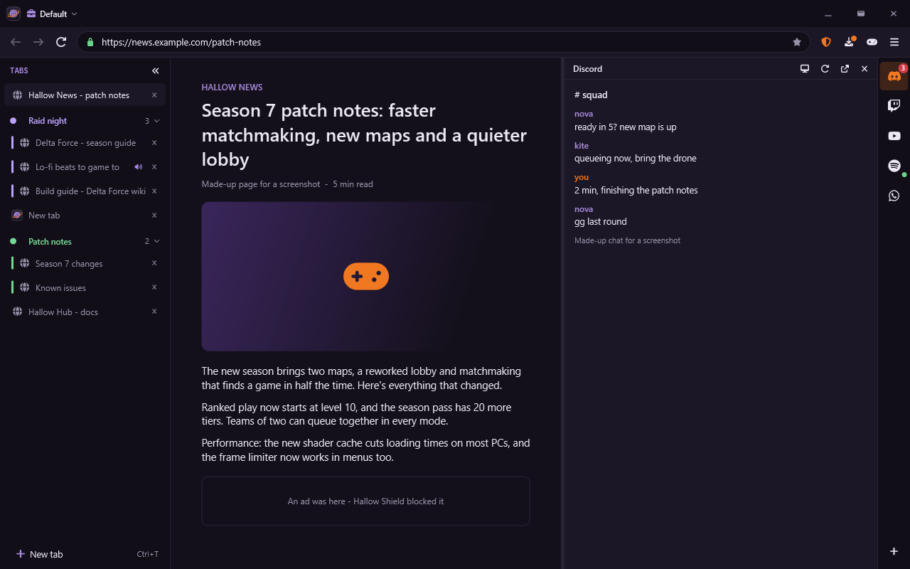

**Vertical tabs** (Settings > Tabs and workspaces, or right-click a tab > Vertical tabs)
- The tabs move into a column on the left, with each site's icon; the **<<** button folds it to **icons only** (hover for the title).
- The gamer sidebar moves to the **right** so the two sit side by side (Settings > Sidebar > Side: away from vertical tabs / left / right).

**Tab groups** (right-click a tab > Add to a new group)
- Named, **coloured** groups (nine colours, each with its own light-mode value that reads at 4.5:1). The group's label sits before
  its tabs; its tabs get a coloured line.
- **Click the label to collapse** the group (its tabs fold away, the label shows how many); right-click it to rename, recolour,
  open a new tab in it, **put the whole group to sleep** (its tabs unload and load again when you click them - not the one you're on,
  not one playing sound), ungroup or close it.
- **Drag a tab onto the label** (or between two of its tabs) to add it; drag it away to take it out. Groups (name, colour, collapsed)
  are **saved with the session**.

**Workspaces** (the switcher at the **top left**)
- Separate sets of tabs and groups - "Gaming", "Work" - each with **its own session** (restored at start, kept in
  `workspaces.json`). They share **one profile**, so you're signed in everywhere. Right-click a tab > Move to *workspace*.
- Honestly: switching closes this workspace's pages and opens the other's, like a restart (fast: only the tab you look at loads).
  A page playing sound in the workspace you leave stops.

**Saved sessions** - in the same switcher: **Save this session...** with a name; **restore** it later - it opens as its own workspace,
so the tabs you have now stay where they are.

**Split view** - **Ctrl+click a tab** to show it beside the one you're on, with a **draggable divider**. Swap the sides or close the
split from the tab's right-click menu (or Ctrl+K). Click into a side and the address bar follows it. Clicking another tab shows that
tab alone; going back to either split tab brings the split back. It's saved with the session.


**Command palette (Ctrl+K)** - one box, fuzzy search ("hbr" finds Hallow Browser) over your **open tabs, history, bookmarks,
commands** (every menu action and every setting - "gaming light", "search with google", "ram limiter 4 gb"...), **sidebar panels**,
workspaces and saved sessions. Enter runs the top one; arrows pick.
- **History** is new: a local store of the pages you visit (address, title, last visit, visits; at most 5,000) in the profile folder
  (`%LOCALAPPDATA%\HallowBrowser\Profile\hallow-history.json`). **Settings > Privacy > Clear history** (or Ctrl+K "clear history")
  empties it; "Clear browsing data" clears it too; you can switch it off.
- **Bookmarks** are new too: **Ctrl+D** (or the star in the address bar) bookmarks the page; Menu > Bookmarks lists them; Ctrl+K finds
  them. (A bookmarks bar and importing come in 1.3.)


**Screenshots (Ctrl+Shift+X)** - the **visible area**, the **full page** (DevTools `Page.captureScreenshot` with
`captureBeyondViewport`, up to 16,000 px tall) or a **region you drag** over a still of the page (Esc cancels). **Copy** to the
clipboard or **save** as PNG to `Pictures\Hallow Browser`.

**Reader mode (F9, or the book in the address bar)** - the book shows on pages that look like articles. Reader mode is our own small
readability-style extractor (no outside library): it scores the page's paragraphs, takes the block holding most of the text with the
fewest links, and leaves out navigation, sidebars, comments, ads and footers. The clean view is drawn by the browser itself in Hallow
typography and **follows light / dark**; **text size** (14-28 px) and **width** (narrow / medium / wide) on its bar. Honestly: it's
text-first - pictures aren't fetched, their captions show - and unusual pages may not split cleanly.


**Mute tab** - the speaker on a tab playing sound is a **button** (mute / unmute); right-click > **Mute all other tabs**.

**Also**: status.json gains `verticalTabs`, `workspaces`, `groups`, `split` (counts only - never names, addresses or titles); the pipe
menu gains "Vertical tabs".

## What's new in 1.1: the gamer sidebar

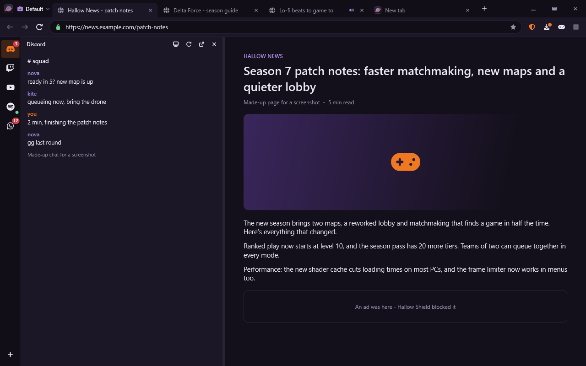

**Sidebar** (Ctrl+Shift+S, or Menu > Show the sidebar)
- Pinned web panels beside the page: **Discord, Twitch, YouTube, Spotify and WhatsApp** to start with; add any site with the **+** at
  the bottom of the rail (or Settings > Sidebar) and remove any with a right-click. "Put the usual ones back" restores the five.
- Each panel is **its own WebView2 on the browser's own profile**, so it **stays signed in** like a tab (and across restarts), gets
  Hallow Shield, Global Privacy Control and the third-party cookie block like a tab. Links that open a new window open as a tab.
- **Phone or desktop version** per panel (a Chrome-on-Android user agent; Twitch and YouTube start as phone versions, which fit a
  narrow panel), and a **width you drag** (280-900 px, remembered per panel). The open panel comes back open next time.
- Panels **load only when you first open them** (nothing at start-up), and a **hidden panel sleeps** (WebView2's TrySuspendAsync)
  after 10 minutes (Never / 1 / 5 / 10 / 30). **In game mode hidden panels sleep at once** - except a panel **playing sound**, so
  Spotify or a stream keeps playing. Opening a sleeping panel wakes it. Right-click > Unload frees all of its memory.
- **Unread badges** from the page title: "(3) Discord" shows a 3 on Discord's icon ([2] and 99+ work too). A green dot marks a
  hidden panel that's playing sound.

**Twitch / YouTube live notifications** (Settings > Live notifications, **off by default**)
- List channels: a Twitch name (shroud, 	witch.tv/shroud) or a YouTube handle (@name, youtube.com/@name).
- Every 5 minutes (the first look a minute after start) Hallow Browser loads each channel's **own public page** -
  https://www.twitch.tv/<name> and https://www.youtube.com/@<handle>/live - one at a time, and looks for the live markers in it
  (Twitch: "isLiveBroadcast":true; YouTube: "isLiveNow":true). **No account, no API key, no third-party service.**
- When a channel goes live you get one notification (again only after it has been offline): through **Hallow Hub's** 
otify when
  Hub runs, otherwise a Windows notification from a short-lived tray icon; clicking it opens the stream in a tab.
- **Honestly: this is page-scraping.** Twitch and YouTube can change their pages at any time, and then it stops seeing streams (it
  says nothing rather than something wrong) until a browser update fixes it. YouTube gets its "reject all" consent cookie so the
  consent page doesn't hide the answer.

**Hot tabs killer** (Shift+Esc, Menu > Hot tabs, or the quick panel)
- Every tab and sidebar panel with **CPU and memory**, hottest first, refreshed every 2 s while open: WebView2's
  GetProcessExtendedInfosAsync says which page process holds each tab's main frame (CoreWebView2.FrameId); CPU is that
  process's processor time between two looks, memory its private bytes. Pages sharing a process show the same numbers ("shared").
  The engine's own processes (browser, GPU, extensions) are one row at the bottom.
- One click: **sleep** (a background tab is unloaded and reloads when you click it; a panel is suspended) or **close** (a tab closes;
  a panel unloads and stays in the sidebar).

**Network bandwidth limiter** (Settings > Speed and gaming: Off / 256 KB/s / 1 / 4 / 10 MB/s; "Only while a game runs" on by default)
- **Honestly: WebView2 has no throttle for the whole browser.** What it has is the DevTools protocol in each WebView, so the cap is
  Network.emulateNetworkConditions (download throughput) **in every tab and panel separately**: each one gets the full cap, so
  five busy tabs can use five times it. It covers what pages load, and in the test also a download a page started (1 MB took 4.5 s
  at 256 KB/s). It **doesn't** cover the engine's own traffic outside pages (its updates, Shield's lists), and nothing outside the
  browser. Measured: a 2 MB transfer took 6 ms uncapped and 8.0 s at 256 KB/s (local test server).

**Light and dark mode** (family spec)
- The browser follows the **mode in %APPDATA%\Hallow\theme.json** (Hallow Toolkit: Light / Dark / Same as Windows - then
  Windows' "apps use light theme"), live; **Settings > Look** can pin it to Light or Dark instead (Follow Hallow is the default).
- Light uses the family palette (background #F6F4FA, panels white, text #1E1A26, lilac #7A5CC0); the accent is darkened for
  text and thin lines until it reaches 4.5:1 on white (orange becomes about #B85410), see-through accent fills keep your accent.
  Title bars, the new tab page, menus and the sidebar follow.
- **Pages** follow the browser when set to **Follow the browser** (the new default; 1.0's "dark" default becomes this - same look
  until you go light) through WebView2's PreferredColorScheme. Dark / Like Windows / Light still pin them.


**Also**: Hallow Shield **1.7** is the built-in default. status.json gains look, sidebar, panels, panelsAwake,
liveNotifications, liveChannels, bandwidthCapKBps (still never addresses or titles), and the pipe menu gains "Sidebar".


## What's in 1.0
**Tabs and window**
- Tabs in the title bar: new, close (button, middle-click, Ctrl+W), drag to reorder, right-click menu (duplicate, mute, pop out video,
  put to sleep, close others), **Ctrl+Shift+T** reopens closed tabs (the last 25).
- Address bar: an address or a search - **DuckDuckGo** by default; Google, Bing or Brave Search in Settings. `javascript:` and `data:`
  are never run from the bar (they're searched). Suggestions from addresses you've used; the top one's connection is warmed up while
  you type (Settings can turn that off).
- Back / forward / reload, downloads list (Ctrl+J), find in page (Ctrl+F, F3), zoom (Ctrl +/-/0, Ctrl+wheel; a zoom chip shows when
  it isn't 100%), print, fullscreen video (and F11), links that open new windows open new tabs (sign-in pop-ups keep working).
- Keyboard shortcuts like Chrome: Ctrl+T / N / W / Shift+T / Tab / Shift+Tab / PgUp / PgDn / 1-8 / 9 / L / E / R / Shift+R / F / G / J / P / , ,
  Alt+Left / Right / D / Home, F5, F6, F11, F12, Esc, Ctrl+Shift+M (mute), Ctrl+Shift+Del (clear data).
- **Session restore**: the tabs from last time come back; background tabs load when you click them (fast start).
- **Dark pages**: pages get `prefers-color-scheme: dark` where they support it (Settings: dark / like Windows / light).

**Hallow look**: the "Hallow console" style - dark purple-black chrome, the Hallow accent from `%APPDATA%\Hallow\theme.json` (live)
and lilac secondaries. Every colour of the browser's own UI is a theme resource (src\Theme.xaml), ready for the family's light mode.

**Hallow Shield, built in** - see [what works inside WebView2](#hallow-shield-inside-webview2). It can't be removed or switched off as
an extension, but everything in it can be set: levels, per-site Strict / Normal / Off and Pause, cookie banners, annoyances, the lists,
My filters, the zapper and stats - Shield's own popup (the shield button) and settings page (Menu > Hallow Shield settings).

**Hallow Keys autofill** - a key appears in the address bar when Hallow Keys has a login for the page; nothing is filled until you click
it and pick a login. See [Hallow Keys](#hallow-keys).

**Speed and gaming**
- **Gaming-light mode**: while a game runs (Delta Force, Discovery, or whatever Hallow Hub says you're playing), background tabs are
  suspended, the browser's processes drop to below-normal priority and a **GAME MODE** chip shows. Tabs playing sound (and a popped-out
  video) stay awake. When the game ends, the tabs it put to sleep wake up again.
- **Tab sleeping**: background tabs you haven't looked at for 15 minutes sleep (Never / 5 / 15 / 30 / 60 min).
- **RAM limiter** (soft, off by default; 2 / 4 / 8 GB): above the cap, the least recently used background tabs sleep, then unload
  (they reload when you click them).
- **CPU limiter**: the browser always runs at below-normal priority, and background tabs ask the engine to use less memory.
- **Pop out video**: the tab moves into a small always-on-top window with its video filling it - it stays on top of games in borderless
  or windowed mode (nothing can draw over an exclusive full-screen game). "Back to tab" puts it back.
- **Hallow quick panel** (the gamepad button or the Hallow logo): game mode and the limiters, browser memory, Hallow Guard's safety
  score, Hallow Mixer, "Save a clip" (Hallow Clips) and Hallow Hub - each only when that app is running.

**Privacy**
- Third-party cookies blocked (Chromium's own setting, written to the profile before the engine starts).
- **Global Privacy Control** (`Sec-GPC: 1` and `navigator.globalPrivacyControl`) and **Do Not Track** sent.
- Microsoft's tracking prevention on Balanced (Strict in Settings). The engine's own password saving and form autofill are off
  (Hallow Keys does that).
- Clear browsing data any time, or optionally every time you close the browser.
- **Honestly:** Hallow Browser has no server and sends nothing anywhere (only GitHub, to look for updates of the browser and of Shield).
  But the page engine is **Microsoft's WebView2 runtime**, which is part of Windows and has its own diagnostic data settings
  (Windows Settings > Privacy & security > Diagnostics & feedback) and Microsoft services such as SmartScreen. That's Microsoft's
  runtime, not a Hallow server.


## Speed (measured on this PC)

**1.9 - the benchmark** (`tests\Bench19.cs`, run by `bench19.ps1`; the installed 1.8 and the new 1.9 back to back on the same day, each in
a throw-away test profile, off-screen, below-normal priority, local pages only). **Note:** Delta Force was running on the PC the whole
time (the tests were asked to go ahead), so every number is higher and noisier than on an idle PC - compare 1.8 and 1.9 with each other,
not with older versions.

| What | 1.8 | 1.9 |
|---|---|---|
| Reaching `Main` (CLR start, warm) | 82 ms (70 in a second run) | 63 ms (62-65) |
| Page engine ready (warm) | 273 ms (282) | 231 ms (227-236) |
| Browser UI drawn - new profile / warm median | 1035 / 710 ms (635 / 697) | 931 / 632 ms (587-638 / 634-650) |
| First page loaded (warm median) | 1024 ms (933) | 875 ms (880-929) |
| New tab, pre-warmed, until drawn (median of 7) | 5.0 ms | 6.1 ms (same within the spread) |
| Scrolling a long local page (rAF deltas, 4 runs alternating) | median 4.2 ms, p95 4.3-16.7 ms | median 4.2 ms, p95 4.3-12.5 ms |
| Memory, 14 pages on 14 different sites (private bytes: engine + browser) | 754 + 109 = 857 MB, 22 processes | 763 + 112 = 867 MB, 22 processes |
| ... the same after 10 min in the background (14 tabs asleep) | 740 + 112 = 842 MB | 748 + 114 = 856 MB |
| CPU / GPU, background video tab + 3 pages, normal / game mode | 0.2 / 0.2 % of one core, GPU 0.01 / 0.00 % | 0.1 / 0.2 %, GPU 0.01 / 0.00 % |

Where start-up goes now (1.9, warm): ~63 ms to `Main` (the CLR; multicore JIT has been on since 1.0), ~85 ms settings and profile,
~35 ms the theme, the WPF window ~165 ms (most of it the first-time JIT of building the title bar and toolbar - the sidebar is ~2 ms),
then the first frame ~200 ms later; the engine is ready at ~230 ms in parallel, the first page loads at ~850-930 ms, Hallow Shield is
loaded at ~820-930 ms. Measured A/B in the same build (`HALLOW_BROWSER_SPEEDOFF`): writing the engine's preference files on another
core and reusing the start settings for the theme draw the window 15-35 ms sooner and have the engine ready ~30 ms sooner.

- **Kept** (measured better): the two start-up changes above; your own extensions load after the first page (Shield never waits).
- **Tried and dropped** (no measurable gain): a low memory target for pages off screen a minute, and in game mode a sleeping pre-warmed
  tab plus slowing background players - the browser already sat at ~0.2 % of one core with the game running.
- **NGen / ReadyToRun**: ReadyToRun is .NET Core only; `ngen.exe install` needs administrator rights, so the installer (no admin) can't
  do it - not done.
- **Memory - why not below 1.8's ~580 MB**: that figure was 14 small pages on one site. The benchmark uses 14 different sites with real
  content, and site isolation gives every site its own renderer (~35-45 MB each) - that is the safety you want and is **not**
  weakened (`--renderer-process-limit=8` only makes tabs of the same site share). A sleeping tab (Chromium freezes it) keeps most of its
  memory; only unloading frees it, which memory saver Max / the RAM limiter do. Hover previews no longer keep their encoded picture.
- **Hardware acceleration** is on and nothing in the browser forces software rendering (the main window isn't a layered window; only
  small flyouts are); the frame times above come from the page's own `requestAnimationFrame`.
- **Speedometer 3** wasn't run: it isn't on this PC and nothing is downloaded - for 2.0, if you agree to run it on browserbench.org.

History (each version's own numbers, measured the way the README said then):

| Version | UI drawn: new profile / warm | First page | New tab (until drawn) | Memory |
|---|---|---|---|---|
| 1.0 | ~610-770 / 550-660 ms | 740-910 ms | median 60-75 ms | ~450 MB, 14 small pages |
| 1.1 | 715 / 546-624 ms | 733-842 ms | median 54 ms | 451 MB |
| 1.2 | 531 / 548-591 ms | 732-763 ms | median 46 ms | 458 MB |
| 1.3 | - / 433-462 ms | 631-653 ms | median 62 ms | 223-233 MB after a restart, 14 tabs |
| 1.4 | 465 / 456-515 ms | 681-801 ms | median 48 ms | 555 MB, 14 small pages |
| 1.5 | 514 / 569-614 ms | about 1.4's | median 48.3 ms | 582 MB, 14 small pages |
| 1.6 | 617 / 616-636 ms | - | 44.9 ms (swap 4.3 ms) | - |
| 1.7 | 477 / 476-493 ms | - | 46.5 ms (swap 3.8 ms) | - |
| 1.8 | 484 / 472-478 ms | - | 48.1 ms (swap 3.8 ms) | - |
| 1.9 (game running, see above) | 931 / 632 ms (1.8 the same day: 1035 / 710) | 875 ms (1.8: 1024) | 6.1 ms (1.8: 5.0) | 867 MB, 14 sites; 856 MB after 10 min |
| 1.10 (game running, quick mode) | 594 / 635 ms (1.9 the same day: 887 / 664) | 911 ms (1.9: 912) | 6.7 ms (1.9: 6.5) | 879 MB, 14 sites (1.9: 878) |

Numbers from the integration test (`tests\Integration.cs`, browser off-screen, Windows 11, WebView2 runtime 158), times from the process
start:

| What | 1.5 (login capture, media and dark-page hooks, previews on) | 1.4 (more windows, site rules, HTTPS-only, Shield count on) | 1.3 (bookmarks, speed dial, Hallow strip on) | 1.2 (measured again: workspaces, groups, history on) | 1.1 | 1.0 |
|---|---|---|---|---|---|---|
| Browser UI drawn (first paint of the window) | 514 ms new profile, 569-614 ms warm - measured the same day, back to back, 1.4 gave 592 ms / 604-618 ms (a busier day than 1.4's own numbers) | 456-515 ms (warm profile, 14 restored tabs); 465 ms on a brand-new profile | 433-462 ms (warm profile, 14 restored tabs) | 548-591 ms (warm profile, 14 restored tabs); 531 ms on a brand-new profile | 546-624 ms; 715 ms new profile | 550-660 ms; ~610-770 ms new profile |
| First page loaded (local test page) | about the same as 1.4 in the main run | 681-801 ms (warm), 825 ms (new profile) | 631-653 ms (warm), 852 ms (new profile) | 732-763 ms (warm), 929 ms (new profile) | 733-842 ms, 1.05 s | 740-910 ms, ~1.0-1.15 s |
| New tab (pre-warmed, until drawn) | median 48.3 ms with tiles (7 tries: 9-79 ms); 56.9 ms in the busier main run. Same day, same script: 1.4 and 1.5 identical (4.4 / 4.5 ms from Ctrl+T to the swap) | median 48 ms with tiles (7 tries: 10-72 ms); 55-80 ms in the busier main run. Measured the same day with the same script, 1.3 and 1.4 were identical (3-8 ms from Ctrl+T to the swap) | median 62 ms (6 tries: 46-78 ms) - the same as 1.2 measured on the same day (63 ms), but now a real page with tiles | median 46 ms (6 tries: 42-77 ms) | median 54 ms (44-75 ms) | median 60-75 ms |
| Memory | 582 MB private with 14 small pages loaded (17 processes) - 1.4 measured 555 MB that way | 555 MB private with 14 small pages loaded (17 processes) - the same as 1.3 measured that way | 223-233 MB private after a restart with 14 tabs | 224-227 MB private after a restart with 14 tabs (13 asleep); 458 MB with 14 small pages loaded (13 processes) | 224-229 MB; 451 MB | ~215-230 MB; ~450 MB |

1.10, measured the same day back to back with the same script while Delta Force was running (off-screen, BelowNormal, throw-away test profiles, quick mode): window first paint 594 / 635 ms (new profile / warm) vs 1.9 887 / 664 ms; first page 911 ms vs 912 ms; pre-warmed new tab median 6.7 ms vs 6.5 ms; scrolling median 4.2 ms both; memory with 14 pages 879 MB vs 878 MB. The Twitch script is registered with every page but returns at its first lines outside twitch.tv; the request filters cover only the ad hosts.

1.8, measured the same day back to back with the same script (off-screen, BelowNormal, throw-away test profiles): window first paint **484 / 472-478 ms** (new profile / warm) vs 1.7 491 / 477-509 ms; pre-warmed new tab swap **median 3.8 ms** vs 1.7 3.8 ms; new tab with tiles until drawn median 48.1 ms in the movein run (46.5 ms in 1.7's; within the run-to-run spread). The new parts add nothing at start or to new tabs: two more WPF buttons; nothing is injected into pages unless SponsorBlock is on, and then only into YouTube videos; the Twitch chat panel is created only when you watch a channel with it switched on; Steam's flag is read only while a launched game is being followed.

1.7, measured the same day back to back with the same script (off-screen, BelowNormal, throw-away test profiles): window first paint **477 / 476-493 ms** (new profile / warm) vs 1.6 511 / 475-493 ms; pre-warmed new tab swap **median 3.8 ms** vs 1.6 3.7 ms; new tab with tiles until drawn median 46.5 ms in the movein run (44.9 ms in 1.6). The new parts add nothing at start: the translate button is one more WPF button and checks the page's language only once a service is set up; the jump list is written at idle 4 s after start; taskbar previews are off by default; the settings search index is built the first time Ctrl+K is asked for a setting; My filters are read from Shield at most every 10 minutes and only when sync is on.

1.6, measured the same day back to back with the same script (off-screen, BelowNormal, throw-away test profiles): window first paint **617 / 616-636 ms** (new profile / warm) vs 1.5 608 / 584-629 ms; pre-warmed new tab swap **median 4.3 ms** vs 1.5 4.2 ms; new tab with tiles until drawn median 44.9 ms in the movein run (48 ms in 1.5). The new parts add nothing at start: the family rows are fetched after the page's first paint and written in the background 1.5 s after start; the profile chip, reading list and notes panels are plain WPF; spell words and the profile list are small files read once; sounds load only when switched on. Startup boost (off by default) draws a window ~130 ms after a new start while boosted.

1.5: the new parts add nothing at start: the login, media and gesture scripts are tiny and only registered with each page; previews are taken 0.7-0.9 s after a tab is shown (never during a game, never for new tab pages); the downloads list is read only when you open it; the private-flyout check is one comparison per element as it appears.

1.4: more windows, site rules and HTTPS-only add nothing at start (plain WPF and per-navigation checks); Shield's copy is made once per Shield version (16 MB, in the background), and the Shield relay runs 20 s after start and then every 5 minutes (a hidden page of Shield's for about a second, never during a game). The game corner is off unless you switch it on.

1.3: the bookmarks bar is plain WPF and is filled when the bookmarks file has been read in the background; the new tab page's tiles come from a small data.json written in the background (at most once a minute for the Hallow strip) - the page itself stays static. The machine was busier on the day 1.3 was measured: 1.2 measured again the same day gave a 63 ms median for new tabs (46 ms when 1.2 shipped), so compare within a column.

1.2's features cost nothing at start either: the tab column, group labels and the workspace switcher are plain WPF; the history and
bookmarks files are read in the background ~2.5 s after the first page; the palette, reader, screenshot and split code only runs when
you use it.

The sidebar costs nothing at start: its rail is plain WPF and panels load only when opened (an open panel comes back ~2 s after
the first page, when the browser is idle).

How: the browser's own UI is plain WPF (no web view for the chrome); the WebView2 environment is started while the window is being built;
one hidden WebView is pre-warmed with the (fully local, no network) new-tab page and becomes the next new tab; restored tabs load only
when clicked; the JIT compiles start-up code on spare cores from a profile of the last start (`ProfileOptimization`); renderer processes
are capped at 8 (Chromium still keeps sites apart where isolation needs it); hardware acceleration stays on. No comparison with Edge's
start-up was made (it would have meant opening Edge on your screen).

## Privacy: what leaves your PC

Hallow Browser has no server. Besides the pages you open, it contacts:
- **GitHub** - to look for updates of the browser and of Shield (sha256-checked).
- **Steam and Epic - only if you switch the game corner on** (off by default). Then, at most every 6 hours and never while a game
  runs: one request per game to `https://api.steampowered.com/ISteamNews/GetNewsForApp/v2/?appid=<id>&count=3&maxlength=1&format=json`
  for up to 8 Steam games from your Hallow Hub library, and one request to Epic's public free-games list
  (`https://store-site-backend-static.epicgames.com/freeGamesPromotions`, the same for everyone). **Only the app ids are sent** - no
  account, no cookies, no other data; like any web request, Steam and Epic see your IP address and that the request came from
  "HallowBrowser/1.4". The answers are kept in `%LOCALAPPDATA%\HallowBrowser\gamecorner.json` and shown as text and links (no pictures
  or scripts from either site). Switch it off and nothing more is fetched.
- **Your search engine's suggestion address - only if you switch search suggestions on** (off by default): what you type in the
  address bar (not addresses, sums or tab searches; never from private windows), as you type. No cookies are sent with it.
- **Your secure DNS provider - only if you pick one** (Cloudflare, Quad9 or Google): it then sees the names of the sites you open
  (not the pages), instead of your Wi-Fi / internet provider.
- 1.10: **Twitch - only on Twitch, only during an ad break, only on channels you didn't allow ads on** (Twitch ads blocking is on by
  default): `gql.twitch.tv` (Twitch's public PlaybackAccessToken query for the channel as another player type, with the public web
  client id twitch.tv itself sends - no cookies, no sign-in) and `usher.ttvnw.net` / Twitch's playlist servers. These are the servers
  that already serve the stream; never a third-party proxy. Once a day, with fixes on: GitHub (this browser's latest release) for a
  newer `hallow-twitch.js` (sha256-checked).
- 1.8: **SponsorBlock - only if you switch "Skip sponsors and intros on YouTube" on** (off by default): for each YouTube video you
  open, `https://sponsor.ajay.app/api/skipSegments/<4 characters>?categories=[...]&actionType=skip` - the first 4 characters of the
  SHA-256 of the video's id (shared by many videos) and the kinds you picked; no address, cookies, referrer or account. SponsorBlock sees
  your IP address, like any request. The Twitch chat panel is Twitch's own page (like a tab), only if you switch it on. Clip it and the
  game launch handoff are local (Hallow Clips' pipe, Hub's status file, Steam's registry flag).
- 1.7: **The translation service you pick - only if you set one up and click Translate** (or said "Always translate" for that
  language): the text of the page (not the address, cookies or form fields) goes to that one service - your own LibreTranslate
  server, DeepL or Google with your own key. Nothing is preset. Shield's My filters and (opt-in, encrypted only) history go only to
  your own sync folder. The jump list and taskbar previews are local.
- 1.6: **Install this site** reads the site's own manifest and icon from that site (like the page itself would), only when you click
  it. The new tab page's games, clips and Overlay switch, spell check (Windows' own checker), the sounds, the reading list and notes
  are all local - nothing goes out (notes only to your own sync folder, when sync is on).

Kept on this PC only: Shield's counts in `%APPDATA%\HallowShield\status.json` (for Hallow Hub and Remote - counts, never sites),
`status.json` (no addresses or titles), history, bookmarks, site settings. Private windows keep nothing but downloads.

## Hallow Shield inside WebView2

Shield 1.7's Chrome build ships inside the package (`shield\`, from Shield's GitHub release, sha256-checked) and is loaded with
`CoreWebView2EnvironmentOptions.AreBrowserExtensionsEnabled` + `CoreWebView2Profile.AddBrowserExtensionAsync`. Tested in the
integration test against local pages (ad hosts pointed at the test server):

| Part | Works in WebView2? |
|---|---|
| declarativeNetRequest (the blocking) | **Yes** - a test ad request (`pagead2.googlesyndication.com/pagead/...`) is blocked, normal scripts load; 10 rule sets enabled |
| Content scripts / scripting / insertCSS (cosmetic filtering) | **Yes** - 23 registered content scripts; a test ad link is hidden. On the very first start the service worker may need a moment, so the first page can miss cosmetic filtering |
| storage | **Yes** (chrome.storage.local) |
| tabs (query / get) | **Yes** |
| The popup | WebView2 has no extension toolbar, so the **Shield button** opens Shield's own `popup.html` in a small window under it, on the extension's origin. The popup asks for "the active tab", which in WebView2 would be that little window - so the browser finds the page's tab id with `chrome.tabs.query` and opens `popup.html?tab=<id>` (Shield's own parameter). Site mode, levels, switches, zapper, filters, stats work there |
| Options page | **Yes** - opens in a tab (Menu > Hallow Shield settings) |
| "Blocked on this page" count | **Yes since 1.4** - WebView2 can't grant optional permissions and Shield's own request gets no answer there, so the browser loads its own copy of Shield with `declarativeNetRequestFeedback` as a required permission (see 1.4) |
| nativeMessaging (Shield's Hallow family bridge) | **No** - not available in WebView2. **1.4 relays the counts itself** into `%APPDATA%\HallowShield\status.json` (see 1.4); the bridge keeps working for Shield in Chrome / Edge |
| InPrivate profiles (private windows) | Shield can be added there but **doesn't run** (no "allow in InPrivate" in WebView2) - private windows use the network-only fallback below |
| Fallback | If the runtime ever refuses the extension, Shield runs **network-only**: its plain block rules (~7,100 `||host^` / `||host/path` rules, no site conditions) through `WebResourceRequested` - no cosmetic filtering, no per-site settings. The browser says so in the Shield panel and Settings. Tested too (`HALLOW_BROWSER_FORCE_FALLBACK`) |

Updates: newer Shield versions come from Shield's own GitHub release (`hallow-shield-chrome-<v>.zip`, checked against GitHub's sha256
digest) into `%LOCALAPPDATA%\HallowBrowser\Shield\<version>` and are loaded at the next start (Settings can turn that off). A browser
update that bundles a newer Shield replaces the old one the same way.


## Hallow Keys

WebView2 has no native messaging, so the browser talks to Hallow Keys directly over the protocol Keys uses for its own browser
extension's native host: the pipe `HallowKeys.Native.<user>` (only this Windows user), one line `<session secret> <json>`, one JSON line
back; the secret is the per-session file Keys writes for this user (`%APPDATA%\HallowKeys\session.key`). Keys answers only while it's
unlocked, and decides itself which logins belong to a page (its own strict rules).

Keys' native host normally checks the *extension's identity*. Hallow Browser does the matching checks itself instead:
- the address sent to Keys is always the tab's real top-level address (from the engine, never from the page);
- a `match` only returns titles and usernames - the key shows only when Keys has logins for the page (and only on pages with a password field);
- **a fill happens only after two clicks**: the key, then a login. Never by itself, never silently;
- the origin (`scheme://host:port`) is pinned when you click the key. If the tab is on any other origin when you pick the login,
  Keys isn't even asked; the fill script checks `location.origin` again inside the page and fills only the top frame (no iframes);
- nothing from Keys is logged or kept; the password exists only in that one fill script.
- **1.5: saving** uses Keys' own `save-check` / `save` requests (the ones its extension sends) with the address of the top-level page
  that sent the login form, only after you click Save; the password is held in memory only while the question is open.

Tests use a stand-in Keys on a separate test pipe with one made-up login - never the real Keys or vault.

## Family link

- Pipe `HallowFamily.Browser.<user>`: `ping`, `status`, `open` (focus), `open <url>` (http/https only), `menu` (New tab, New window,
  New private window, Reopen closed tab, Reopen closed window, Downloads, Gaming-light mode, CPU limiter, Sidebar, Vertical tabs), `invoke <id>`, `quit` (every window). `HallowBrowser.exe --cmd "<line>"` for scripts.
- `%APPDATA%\HallowBrowser\status.json`: `tabs`, `asleep`, `gameMode`, `game`, `shield` (extension / fallback / missing), `shieldVersion`,
  `runtime`, `lastCrash`; 1.1: `look`, `sidebar`, `panels`, `panelsAwake`, `liveNotifications`, `liveChannels`, `bandwidthCapKBps`;
  1.2: `verticalTabs`, `workspaces`, `groups`, `split`; 1.3: `bookmarksBar`, `sync`; 1.4: `windows`, `privateWindows`, `httpsOnly`,
  `secureDns`, `extensions` (how many are on), `gameCorner`; 1.5: `forceDark`, `searchSuggestions`, `mediaTabs`, `downloadsRunning`; 1.6: `profiles` (how many),
  `boosted`, `appWindows`, `memorySaver`, `onBattery`, `memorySavedMb`, `readingList`, `sounds` - never addresses, titles, history,
  profile / workspace / group names.
- 1.6: the pipe and status.json are the Default profile's; another profile answers on `HallowFamily.Browser-<id>.<user>` (the hyphen
  keeps it out of Hub's list of apps); Default's `menu` adds "Open profile: <name>" (`invoke profile-<id>`). `app <url>` opens an
  installed site's window. `quit` really exits (also a startup-boosted process).
- 1.6 reads Hub's `hub.json` / `status.json` and `meta\<id>\shot0.jpg`, Clips' and Overlay's `status.json`, and sends Hub `play
  steam:<id>` (only on Play; Hub 2.16 answers "unknown command" and the game's own Steam link is used) and Overlay `toggle` (only
  on the switch).
- Live notifications go through Hub's `notify Browser<TAB>title<TAB>text` when Hub runs (Hallow Browser has no tray icon of its own;
  without Hub a short-lived tray icon shows the balloon).
- Hallow Hub's generic host lists it while it runs. The Hallow accent (theme.json), crash reports (`%APPDATA%\HallowBrowser\crashes`,
  kept on this PC) and the GitHub updater (sha256-checked) work like in the other apps.

## Where things are

| What | Where |
|---|---|
| The browser | `%LOCALAPPDATA%\Programs\Hallow Browser\` (HallowBrowser.exe, Microsoft's WebView2 DLLs, `shield\`) |
| Browsing data (profile: cookies, cache, history, Shield's settings; 1.2: `hallow-history.json`, the history Ctrl+K searches) | `%LOCALAPPDATA%\HallowBrowser\Profile` |
| Settings, open tabs, status, crash reports; 1.2: workspaces.json, saved-sessions.json, bookmarks.json (1.3: with folders); 1.3: sync-state.json (what this PC last synced), sync-merged\ (cloud conflict files merged in) | %APPDATA%\HallowBrowser |
| 1.3: the new tab page and its tiles (newtab\index.html, newtab\data.json), the sync password (sync-password.bin, protected by Windows for your user) | %LOCALAPPDATA%\HallowBrowser |
| 1.3: the sync file (Hallow Browser sync.hbsync, encrypted if you set a password) | the folder you picked in Settings > Sync |
| Screenshots you save | `Pictures\Hallow Browser` |
| Shield updates | `%LOCALAPPDATA%\HallowBrowser\Shield` |
| 1.4: the Shield copy the browser loads (with the feedback permission), your extensions' copies, the game corner's cache (gamecorner.json), newtab\private.html | `%LOCALAPPDATA%\HallowBrowser\ShieldLoaded`, `...\Extensions`, `...\gamecorner.json` |
| 1.4: site settings (pop-ups, sound, JavaScript, http allowed) and your extensions' list | settings.json in %APPDATA%\HallowBrowser (permissions themselves are in the profile) |
| 1.4: Shield's counts for Hallow Hub / Remote | `%APPDATA%\HallowShield\status.json` (merged with Shield's bridge's entries) |
| 1.6: the list of profiles (and the spell check language), the copy of 1.5's settings files made on the first 1.6 start | `%APPDATA%\HallowBrowser\profiles.json`, `...\backup-1.5` |
| 1.6: another profile's files (settings, tabs, bookmarks, reading list, notes...; its history, apps, new tab page) | `%APPDATA%\HallowBrowser\Profiles\<id>`, `%LOCALAPPDATA%\HallowBrowser\Profiles\<id>`; its engine profile: `...\Profile\EBWebView\WV2Profile_hallow_<id>` |
| 1.6: the reading list and notes (Default) | `%APPDATA%\HallowBrowser\reading-list.json`, `notes.json` |
| 1.6: installed sites (list and icons), their Start menu shortcuts | `%LOCALAPPDATA%\HallowBrowser\apps`, Start menu > Hallow Browser Apps |
| 1.6: the sounds (written from the app when first played), words you added to the dictionary | `%LOCALAPPDATA%\HallowBrowser\sounds`, the engine profile's `Custom Dictionary.txt` |
| 1.7: your translation API keys (protected by Windows for your user; never synced) | `%LOCALAPPDATA%\HallowBrowser\translate-keys.bin` (another profile: its own Local folder) |
| 1.10: a newer Twitch script from the release (when there is one) | `%LOCALAPPDATA%\HallowBrowser\Twitch\hallow-twitch.js` (the built-in one is inside HallowBrowser.exe) |
| 1.8: SponsorBlock's answers | in memory only (30 minutes), never written to disk |
| 1.12: the registration with Windows (a browser you can pick - never your default) | `HKCU\Software\Classes\HallowBrowserURL`, `...\HallowBrowserHTML`, `...\.html\OpenWithProgids` (and the other file types), `HKCU\Software\Clients\StartMenuInternet\HallowBrowser`, `HKCU\Software\RegisteredApplications` |
| 1.7: the jump list | Windows keeps it (`%APPDATA%\Microsoft\Windows\Recent\CustomDestinations`); Settings > Appearance > Taskbar turns it off (an empty list) |

Uninstall from Windows Settings > Apps; it asks whether to remove your browsing data too.

## Build

Nothing to install: `build.ps1` uses the C# compiler that comes with Windows (.NET Framework 4.8, C# 5).

```
.\tools\get-shield.ps1     # Shield 1.7's Chrome build into package\shield (from its GitHub release, sha256-pinned)
.\build.ps1 -Tests         # HallowBrowser.exe (x64) and tests\BrowserTests.exe (1.6: runs tools\gen-sounds.ps1 first - the sounds are synthesised, then embedded)
tests\BrowserTests.exe     # unit tests
tests\BrowserTests.exe --integration HallowBrowser.exe <work folder> main|fallback|sidebar|power|movein|v14|v15|v16|v17|v18|v19|v110|v112|bench
```

The WebView2 SDK DLLs are in `lib\`: **Microsoft.Web.WebView2 1.0.4314.35** (NuGet), package sha256
`90778deb1b77e36292828b4b5833c9255c27533f40e0ddd55891ae718944edc4`; the package and all three DLLs are Authenticode-signed by
Microsoft Corporation. Only `Microsoft.Web.WebView2.Core.dll`, `Microsoft.Web.WebView2.Wpf.dll` (lib\net462) and
`runtimes\win-x64\native\WebView2Loader.dll` are used.

Tests: unit tests (address bar and search parsing, origins and the Keys fill rules, game mode / tab sleeping / RAM limiter decisions,
settings, Shield's fallback rules and update picking, the theme, the family pipe, the Keys protocol against a stand-in); integration
tests drive the real browser off-screen (never shown, never focused) with its own test profile and pipes, against local pages from a
tiny server: Shield blocking and cosmetic filtering, Shield's popup and options page, third-party cookies (and a control run with the
setting off), GPC/DNT headers, dark pages, Keys filling only after the click and refusing an origin change, game mode with a fake game
(suspended tabs, awake audio tab, priority), close / reopen, pop-out, find, zoom, downloads (to the test folder), the family pipe, speed
and memory, session restore. 1.1 adds (unit) unread badges, panel sleeping, sites and user agents, live-page parsing, CPU maths,
the cap, light/dark resolution, the light theme with contrast checks for every pair, the 1.0 -> 1.1 settings; and (integration
"sidebar", local panel pages, fake Twitch/YouTube pages, a stand-in Hub) a panel's sign-in cookie surviving a restart, badges, phone /
desktop user agents, sleeping after the time / at once in game mode / not while playing sound, the hot tabs list and its buttons, the
cap slowing a 2 MB transfer, live notifications via the tray path and via Hub, light/dark switched live from theme.json and pages
following. 1.2 adds (unit) group order and drops, group colours at 4.5:1 in both looks, fuzzy search, the history store (one entry per
address, newest first, 5,000 cap, nothing written before the file was read, clear), bookmarks, workspace names and splits, 1.1
sessions still loading and 1.2 sessions keeping groups / split, the new settings, the reader document, screenshot crops and file
names; and (integration "power", local pages) vertical tabs and groups (new, drag in / out / onto a label, colour, collapse) surviving
a restart, sleeping a whole group, workspaces keeping separate sessions (also across a restart), saving and restoring a named session,
split view loading two pages side by side (swap, saved with the session), Ctrl+K finding a tab, a history entry, a command, a setting
and a panel and running them, history in the profile folder and Clear history, Ctrl+D, screenshots as PNGs (the full page taller than
the viewport, a region at half size; "copy" in a test folder never touches the clipboard), reader mode extracting a test article
without its nav / ads / sidebar / comments / footer, and mute (the speaker button, Mute all other tabs). Page pictures come from
`CapturePreviewAsync`, the browser UI from `HallowBrowser.exe --snap <folder>` (every picture in light and dark). 1.4 adds (unit)
where a dragged tab goes (reorder / another window / a new window, the drop slot), the HTTPS-only rules (what's upgraded, test port
pairs, which errors ask, the page escaped and in both looks), secure DNS in Local State (written, unchanged, removed, a broken file left
alone), site rules and permission names, Shield's patched manifest, the status.json relay (merging with other browsers, replacing our
entry by id, the sums, only the bridge's fields), unpacked extension manifests (_locales names, MV2 / MV3 popups), the game corner
(Hub's library, Steam's news in its real response shape, Epic's free / upcoming games, every 6 hours, the page data), the private
palette's contrast, sessions with more windows and 1.4's settings; and (integration "v14", local pages and stand-ins only - a local
DoH server and https server with a throw-away self-signed certificate accepted only in tests, stand-in Steam / Epic endpoints) secure
DNS really going through the DoH stand-in, http upgraded to https and the "not secure" page with its own Continue button, a
geolocation request answered through the prompt's code (never Windows' location), saved / one-time / blocked permissions and Reset,
JavaScript / pop-ups / sound / cookies per site, Shield's "blocked on this page" number and the status.json relay merged with another
browser's entry, a test unpacked extension (content script, popup, off, removed), new windows and moving a live page between windows
without a reload, a private window leaving nothing in the session / workspaces / settings / history files (downloads kept, its own
cookies, Shield's fallback blocking), the game corner (off = nothing fetched; only app ids sent; on the new tab page; not again within
6 hours), and both windows coming back after a restart. 1.10 adds (unit) Twitch ad handling's settings (on by default, also for
1.9's settings files; the allow list cleaned), which requests are blocked (ad hosts - never spade, countess, GraphQL, chat, emotes or
look-alike hosts), what counts as twitch.tv, the script's version line and update rules, and that the script names no server but
Twitch's own; and (integration "v110", a local fake Twitch: player pages whose Web Worker - made from a blob address revoked at once,
like Twitch's - fetches a master and media playlists with stitched-ad `DATERANGE` segments and every segment in them, a fake usher, a
fake GraphQL endpoint handing out tokens for other player types, chat / emote / beacon stand-ins and a GitHub release stand-in) no ad
segment ever requested when an alternative is clean (the same quality, Twitch's client id, no cookies), the cover with its countdown
and the video and tab muted when every alternative has the ad, lifted after the tag's duration, channels on the allow list played
untouched (no other stream asked for, display ads and beacons through), "Support <channel>" from the Twitch button, a private window
blocking too, chat / emotes / channel points / spade still working, off = nothing touched, and a script update refused on a wrong
sha256 and used from the next page load on the right one. 1.8 adds (unit) which addresses are YouTube videos and Twitch channels, the
4-character SHA-256 prefix and the exact SponsorBlock request (no video id in it), picking our video's skip segments out of an answer for
many, everything off by default, the launch handoff's rules (at once, Steam / Hub / the process, closed, never showed up) and the Skip
button's contrast; and (integration "v18", a stand-in SponsorBlock server, a YouTube-like page with a real `<video>`, a Twitch-like page,
a stand-in Clips pipe and Hub folder, launch links to a log) nothing contacted while off, the request's prefix / headers, auto skip with
Undo, the Skip button, categories, moving between videos in the page, the memory cache, SponsorBlock failing, the chat panel beside
full screen and theatre mode, Twitch's theatre button, Clip it (not running / not recording / paused / off screen / saved / Clips'
error) and game mode at once until the game closes. 1.6 adds (unit) the migration of a fake 1.5 folder into the Default profile
(every file compared before / after, the backup, settings and tabs loading as before), profile ids / folders / WebView2 profile names /
pipes / arguments, Chromium's dictionary file and its checksum, memory saver levels and the battery rule, the synthesised WAVs (format,
no clipping, a seamless loop), manifest parsing / scope / square icons / a readable .ico / a shortcut in the test folder, the family rows
from stand-in files, the reading list and notes, notes through sync between two test PCs (encrypted), and the new colours' contrast in
the dark, light and private looks; and (integration "v16", local pages and stand-ins only - stand-in Hub / Clips / Overlay files and
pipes, launch links written to a log, never opened) the first start on a fake 1.5 folder, a Gaming profile in its own process (same
engine, separate cookies, its own private profile, Shield, its own sync sub-folder), the family rows on a real new tab page (Play, a
clip and the Overlay switch clicked in the page, rows hidden when an app isn't there, loaded after the first paint), installing two
sites (manifest and favicon), the app window and its scope, the shortcut's command handed to the running profile, Uninstall, spell
check suggestions and Add to dictionary across a restart, the reading list and notes panels and encrypted notes sync, memory saver
levels, battery throttling measured in the page, "memory saved", sounds at volume 0 (and muted in a fake game), and startup boost
(closed, then woken by a new start).

## Credits

- **Microsoft Edge WebView2** SDK (Microsoft.Web.WebView2 1.0.4314.35), (c) Microsoft Corporation, BSD-style licence - redistributed
  as it allows (`WebView2-LICENSE.txt`, `WebView2-NOTICE.txt`). The WebView2 runtime itself is Microsoft's and isn't shipped.
- **Hallow Shield** (Dom428/hallow-shield) and its filter lists (uBlock Origin's lists, EasyList, EasyPrivacy and others - see
  `shield\LISTS-LICENSE.txt`).
- **Twitch**: 1.10's ad handling is the browser's own code (no third-party code); it uses Twitch's public PlaybackAccessToken query
  and web client id the way twitch.tv itself does.
- **SponsorBlock** (sponsor.ajay.app, by Ajay Ramachandran and its contributors): YouTube segment data through its public API, licensed
  **CC BY-NC-SA 4.0** - fetched when you turn the option on, used as it comes, non-commercially, kept in memory only.
- Icons: **Font Awesome Free** 7.3.1 (CC BY 4.0, `FontAwesome-LICENSE.txt`).
