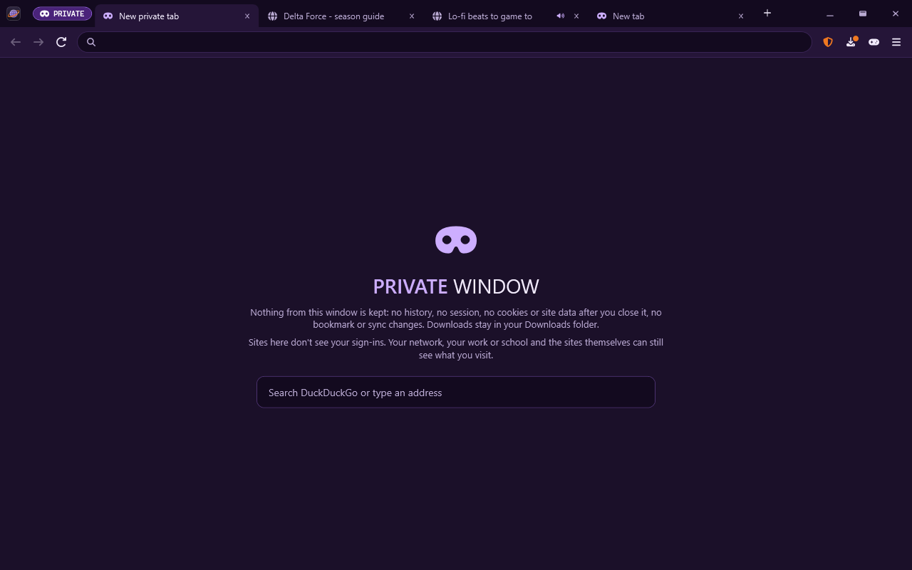
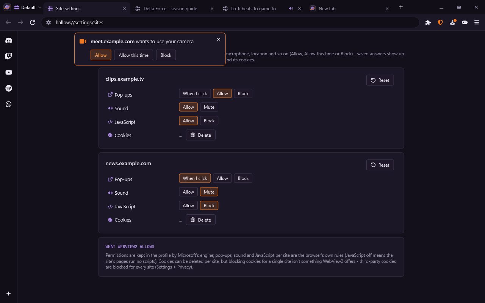
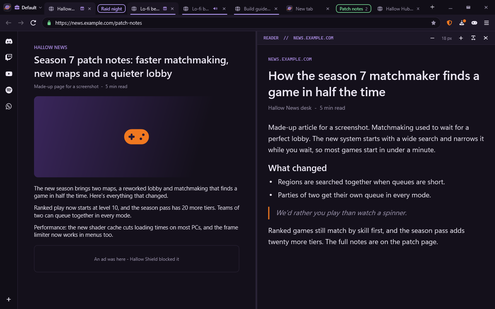
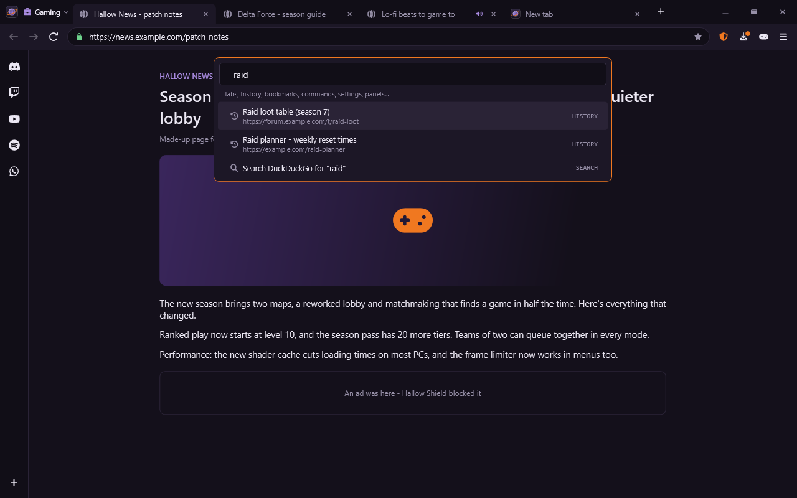
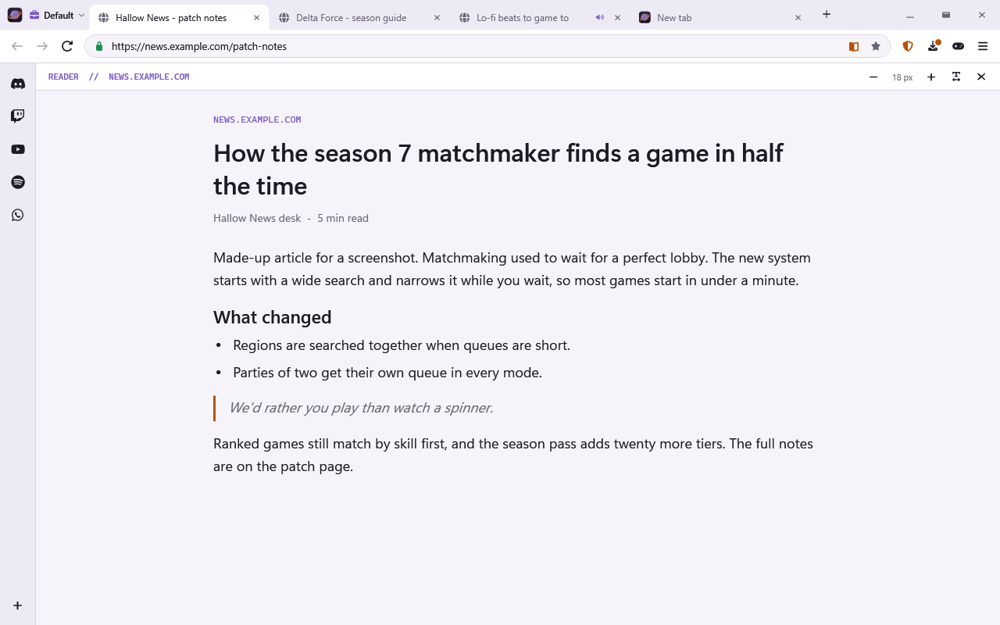
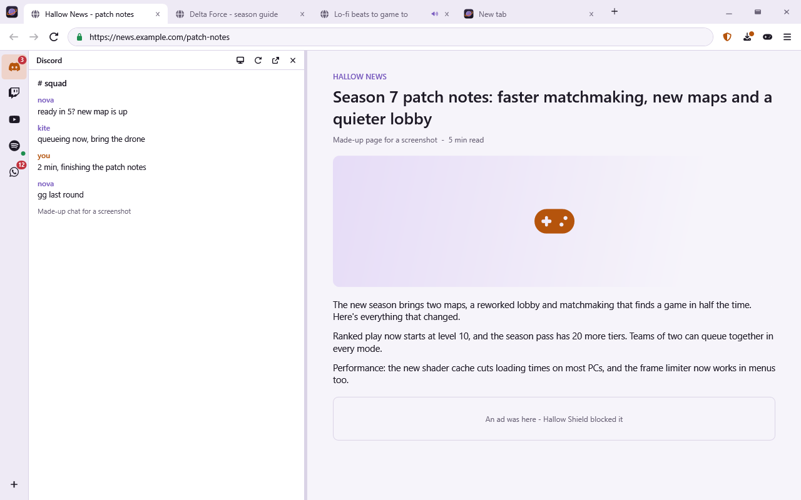
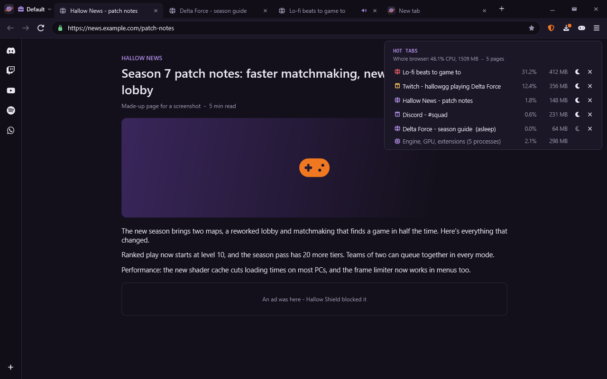
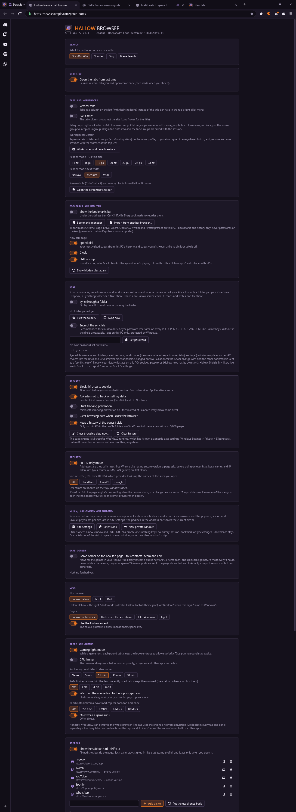

# Hallow Browser

A fast Chromium browser for gamers, in the Hallow style. **Hallow Shield is built in**, a **gamer sidebar** keeps Discord, Twitch,
YouTube, Spotify and WhatsApp signed in beside the page, **Hallow Keys** fills your logins when you click, and **gaming-light mode**
puts background tabs (and sidebar panels) to sleep while you play. 1.2 adds the power features: **vertical tabs, tab groups,
workspaces, split view, a command palette (Ctrl+K), screenshots, reader mode** and saved sessions; 1.3 helps you **move in** -
**bookmarks and history from Chrome, Edge, Brave, Opera, Opera GX, Vivaldi and Firefox**, a **bookmarks manager and bar**, **sync
through a folder you pick** (OneDrive, Dropbox, Syncthing, a NAS) and a **speed-dial new tab page**. 1.4 brings **real windows**
(Ctrl+N, drag a tab out), **private windows**, **site permissions**, **HTTPS-only mode and secure DNS**, **your own extensions**,
Shield's **"blocked on this page"** number and an opt-in **game corner**. It runs on **Microsoft Edge WebView2** - the Evergreen
runtime that already comes with Windows 11 - so pages render exactly like in Edge and Chrome, and the browser itself is small (a
~870 KB app plus Microsoft's WebView2 DLLs).



Part of the Hallow family (Mixer, Hub, Vault, Overlay, Remote, Clips, Keys, Assist, Guard, Shield, Setup, Toolkit).

## Download

Get **Hallow.Browser.zip** from the [latest release](https://github.com/Dom428/hallow-browser/releases/latest), unzip it and run
**INSTALL.bat** (no admin needed). It installs to `%LOCALAPPDATA%\Programs\Hallow Browser\HallowBrowser.exe` with Start menu and
Desktop shortcuts. Or install it from [Hallow Setup](https://github.com/Dom428/hallow-setup).

Hallow Browser **never makes itself your default browser**. It registers as a browser you *can* pick, so if you want it for links,
choose it yourself in Windows Settings > Apps > Default apps.

Needs: Windows 10/11 x64 with the **Microsoft Edge WebView2 Runtime** (Windows 11 has it). If it's missing, Hallow Browser says so and
opens Microsoft's WebView2 page when you click - it never downloads the runtime itself.

## What's new in 1.4: windows, privacy and your own extensions

**More than one window**
- **Ctrl+N** opens a new window (menu > New window). **Drag a tab out of the strip** to give it its own window where you let go, or
  **into another window's strip** to move it there - the page moves as it is (it isn't reloaded: the same WebView goes along).
- Each window keeps **its own tabs, groups and split view** in the session and comes back next time. A new window gets its own
  workspace ("Window 2"); the workspace switcher shows which workspaces are open in another window, and switching to one that's open
  elsewhere brings that window forward. Closing a window (not the last) closes its tabs - and its "Window n" workspace, unless you
  switched it to another workspace first. **Closing the last window quits**; menu > Exit closes every window and keeps them all for
  next time.
- Sync, live notifications and Shield's relay run once, in the first window (the next one takes over if you close it).

**Private windows** (Ctrl+Shift+N, menu > New private window)
- A separate WebView2 profile with **InPrivate mode** (`CoreWebView2ControllerOptions.IsInPrivateModeEnabled`): its cookies, cache
  and site data are thrown away when the last private window closes, and pages there don't see your normal sign-ins.
- **Nothing is written**: no history (Ctrl+K's history, the address bar's typed list), no session or workspace, no bookmark, bookmarks
  bar, new-tab-page or sync changes (the star and the bar are hidden there). **Downloads are still kept** in your Downloads folder.
- Its own look: **dark purple** whatever the light / dark mode, a **mask** and a PRIVATE chip in the title bar, and its own new tab
  page. The sidebar isn't there (its panels are signed in on your normal profile).
- **Shield in private windows:** WebView2 lets Shield be *added* to an InPrivate profile, but it **doesn't run there** (tested: the
  test ad request went through; Chromium runs extensions in private windows only when they're "allowed in InPrivate", and WebView2 has
  no switch for that). So private windows get **Shield's network-only fallback** - its ~7,100 block rules through
  `WebResourceRequested` (no cosmetic filtering, no per-site settings). Tested: the test ad request is blocked there.

**Site permissions and site settings**
- The engine's permission requests come to a **Hallow prompt** under the address bar - "*site* wants to use your camera" - with
  **Allow** (saved), **Allow this time** and **Block** (saved): camera, microphone, location, notifications, clipboard, MIDI devices,
  motion sensors, window placement, local fonts, files and several downloads at once (`PermissionRequested` with a deferral; the
  answer is saved in the profile with `SavesInProfile`, so WebView2 doesn't ask again). Autoplay and storage keep the engine's default.
- **Site settings** (`hallow://settings/sites`, menu > Site settings): every site with settings of its own - its permissions
  (Allow / Block / Ask, from `GetNonDefaultPermissionSettingsAsync`, changed with `SetPermissionStateAsync`), **pop-ups** (blocked unless
  you clicked - like other browsers - or Allow / Block), **sound** (Mute), **JavaScript** (Block: `IsScriptEnabled` off for that site's
  pages), insecure http allowed, and **cookies** (count, Delete). **Reset** per site.
- The **padlock** in the address bar is a button now: the connection (https or not) and the current site's settings.
- Honestly: WebView2 has no per-site cookie *blocking* - the browser can delete a site's cookies, and third-party cookies stay blocked
  everywhere (Settings > Privacy).

**HTTPS-only mode and secure DNS** (Settings > Security)
- **HTTPS-only** (on by default): an `http://` address (port 80) is opened as `https://` first. If the secure version doesn't answer,
  has a bad certificate or sends you back to http, a Hallow page says **"This site doesn't support a secure connection"** with **Go
  back**, **Continue to the site (not secure)** (until the browser restarts) and **Always allow this site** (listed in Site settings).
  Nothing is sent over http before you agree. Local names and IP addresses (localhost, `router`, `nas.local`, `192.168.x.x`, LAN game
  servers) are left alone, like other browsers do.
- **Secure DNS** (DNS over HTTPS): **Cloudflare, Quad9, Google** or Off. **A change needs a browser restart** (Settings says so).
  How: Chromium keeps this in the engine's `Local State` (`dns_over_https.mode = secure` + the provider's template), which the runtime
  reads when it starts - the browser writes it before the engine starts. **Tested for real** with a local DoH stand-in: a name only
  the stand-in knows opened, every lookup went there (Microsoft's own background lookups too), and a name it didn't know didn't open -
  no quiet fallback to Windows' DNS. The feature-flag route (`--enable-features=DnsOverHttps:...` in `AdditionalBrowserArguments`)
  did **nothing** on its own in WebView2 158, so it isn't used. In secure mode, if the provider can't be reached, pages don't load.

**Your own extensions** (`hallow://extensions`, menu > Extensions)
- **Load unpacked...**: pick an extension's folder (the one with `manifest.json`). It's copied into the browser's data
  (`%LOCALAPPDATA%\HallowBrowser\Extensions`) and loaded with `AddBrowserExtensionAsync`; **switch it on / off** (`EnableAsync`) or
  **Remove** it (the browser's copy is deleted, never your folder). Loading a newer folder of the same extension replaces it.
- Their buttons are under the **puzzle piece** in the toolbar (an overflow menu); a popup opens in a flyout like Shield's.
- **Hallow Shield stays built in** - listed as "Built in", it can't be removed.
- **Chrome Web Store installs aren't possible in WebView2** (Microsoft's engine has no store support). Instead: get the extension's
  source or release zip from its developer (many publish one on GitHub), unzip it and Load unpacked. Updates don't come by
  themselves - load the newer folder. Some extension APIs are missing in WebView2 (native messaging, permission prompts), and
  extensions don't run in private windows.

**Shield: "blocked on this page" and the Hallow family counts**
- WebView2 has **no API to grant an extension an optional permission**, and Shield asking for it itself (`chrome.permissions.request`,
  from its popup, with a click) **never gets an answer** in WebView2 (tested: no prompt, the promise just waits). So the browser loads
  **its own copy of Shield** (`%LOCALAPPDATA%\HallowBrowser\ShieldLoaded\<version>`, made once per Shield version) in which
  `declarativeNetRequestFeedback` is a *required* permission. Same extension id (the manifest's key), and it's added **over** the
  installed Shield, which keeps Shield's settings, filters and stats (tested; 1.3 removed and re-added it on Shield updates, which
  lost them). Now the popup shows **"N ads and trackers blocked on this page"** (`getMatchedRules` for that tab) and Shield keeps its
  blocked counts (Stats).
- **Family bridge without native messaging:** every 5 minutes the browser opens a page of Shield's own origin (its `family.js`, never
  shown), which reads Shield's stats and builds the report with **Shield's own `familyReport()`** - `blockedToday, blockedWeek,
  bannersToday, level, version, browser, profile, day`, never a site - and merges it into **`%APPDATA%\HallowShield\status.json`** in
  the bridge's format (same mutex, atomic replace), **keeping the other browsers' entries** (ours is "Hallow Browser"). Hallow Hub and
  Remote show it like Shield's counts from Chrome. Settings > Hallow Shield > "Share Shield's counts with Hallow Hub and Remote" (on;
  local only).

**Game corner** (new tab page - **off by default**, Settings > Game corner: "this contacts Steam and Epic")
- **News** for the games in your **Hallow Hub library** (Hub's `hub.json`, read only: the Steam app ids of the games you last played,
  hidden ones left out) through Steam's public news API (`ISteamNews/GetNewsForApp/v2`, 3 items each, no key), and **Epic's free
  games** (now and next) from its public promotions list.
- Fetched **at most every 6 hours** (an hour after a failed try), **never while a game runs**, kept in
  `%LOCALAPPDATA%\HallowBrowser\gamecorner.json`. The new tab page shows text and links only, from that local copy - no pictures or
  scripts from Steam or Epic. See [Privacy](#privacy-what-leaves-your-pc).
- On this PC, Epic's endpoint didn't resolve (the DNS in use answers "no such domain" for it), so the free-games half was only
  checked against a stand-in in Epic's response format; Steam's format was checked once against the real API (read-only).



## What's new in 1.3: moving in and syncing

**Import from another browser** (Bookmarks manager > Import from a browser..., the menu, or Ctrl+K)
- Finds **Chrome, Edge, Brave, Opera, Opera GX, Vivaldi and Firefox** profiles on this PC and lists them with their counts
  (bookmarks, pages of history). Tick bookmarks and/or history per profile and click Import.
- **Read-only**: the files are copied to a temp folder first (browsers keep them open) and read there; the copies are deleted
  afterwards. Hallow Browser never writes to another browser's profile.
- Bookmarks go into an **"Imported from Chrome"** (etc.) folder under Other bookmarks, with the other browser's folders kept inside.
  **No duplicates**: a page you already have bookmarked anywhere is skipped, so importing twice adds nothing.
- History joins the pages Ctrl+K finds (most visits and the newest visit are kept for a page you already had; at most 5,000 pages).
- **Passwords and cookies are never imported.** Passwords belong in Hallow Keys, which has its own importer.
- How, with nothing downloaded and no SQLite library: Chromium's `Bookmarks` is JSON; Chromium's `History` and Firefox's
  `places.sqlite` are SQLite files, read by a small **read-only SQLite reader** written for this (b-tree pages, overflow pages,
  records, and the `-wal` file next to it, checksums checked - so recent visits are there even while the browser runs). Firefox
  bookmarks come from its newest `bookmarkbackups\*.jsonlz4` (Mozilla's LZ4 format, decompressed by our own LZ4 decoder). Any
  browser's exported bookmarks HTML file works too.

**Bookmarks manager** (`hallow://bookmarks`, Ctrl+Shift+O, or the menu)
- Folders on the left (Bookmarks bar, Other bookmarks and everything inside), the folder's bookmarks on the right, a search box.
- **New folder**, **rename / edit the address** (the pencil or right-click), **delete** (a folder goes with what's in it),
  **drag to reorder** or drag onto a folder (in the list or on the left).
- **Export HTML file** / **Import HTML file** - the Netscape bookmark format every browser reads and writes.
- **Bookmarks bar** (Ctrl+Shift+B, off by default): under the address bar; folders open as a list, drag to reorder, right-click for
  edit / delete / new folder, a >> list for what doesn't fit. Ctrl+D adds the page to the end of the bar. 1.2's bookmarks are on it.

**Sync through a folder you choose** (Settings > Sync, **off by default**) - OneDrive, Dropbox, a Syncthing folder or a NAS share
- Syncs **bookmarks and folders, saved sessions, workspaces** (the one you're in keeps its open tabs), **settings** (not window places
  or per-PC choices like the RAM and CPU limiters) and **sidebar panels**. The same model as Hallow Keys 2.0's sync, simplified:
  every item has a version vector; an item changed on two PCs keeps the newer change, and a bookmark or saved session changed on
  both is kept twice - the other one as "(conflict copy from PC-NAME)", the same on every PC; an edit wins over a delete it hadn't
  seen; cloud clients' conflict files ("... (1).hbsync", Dropbox's "conflicted copy", Syncthing's ".sync-conflict-") are merged in
  and moved out of the folder (kept in `sync-merged`). A PC joining a folder takes the folder's settings.
- **Optional encryption** (recommended for cloud folders - Settings says so when the folder looks like OneDrive / Dropbox / Google
  Drive): a sync password -> PBKDF2-SHA256 (600,000 rounds) -> AES-256-GCM, like Hallow Keys. Without it the file can't be read.
  The password is kept on this PC only, protected by Windows (DPAPI).
- **Not synced**: history (it stays on this PC), cookies, passwords (Hallow Keys syncs its own). Hallow Shield's My filters live inside
  Shield (the extension), not in the browser - use Export / Import in Shield's settings.

**New tab page**
- **Speed dial**: your most visited pages (from this PC's history - imported history counts) and pages you **pin** (the star on a
  tile, or Ctrl+K > Pin this page); the x takes a tile off. A **search box**, an optional **clock**, and the **Hallow strip**: Guard's
  score, what Shield blocked today and what's playing, from the other Hallow apps' status files. All local - nothing is loaded from
  the network.
- **Fixed**: on current WebView2 runtimes 1.2's new tab page showed an error page ("can't reach this page"): the runtime no longer
  serves a folder address of a mapped folder. 1.3 opens the page by name (`https://newtab.hallow/index.html`) and tells the engine
  that the made-up host `newtab.hallow` doesn't exist, so it never waits for (or sends) a DNS lookup for it - that wait held every
  fresh new-tab page for ~2 s.

**Also**: light mode reads better - accent buttons and the GAME MODE chip are a filled accent with white or near-black text (as
Hallow Toolkit 5.16), the text accent is darkened against the darkest light surface (#EEEAF5) too, lilac text is #7758BF, sync
status text uses darker green / amber. status.json gains `bookmarksBar` and `sync` (off / synced / waiting / error).

## What's new in 1.2: power features


**Vertical tabs** (Settings > Tabs and workspaces, or right-click a tab > Vertical tabs)
- The tabs move into a column on the left, with each site's icon; the **<<** button folds it to **icons only** (hover for the title).
- The gamer sidebar moves to the **right** so the two sit side by side (Settings > Sidebar > Side: away from vertical tabs / left / right).

**Tab groups** (right-click a tab > Add to a new group)
- Named, **coloured** groups (nine colours, each with its own light-mode value that reads at 4.5:1). The group's label sits before
  its tabs; its tabs get a coloured line.
- **Click the label to collapse** the group (its tabs fold away, the label shows how many); right-click it to rename, recolour,
  open a new tab in it, **put the whole group to sleep** (its tabs unload and load again when you click them - not the one you're on,
  not one playing sound), ungroup or close it.
- **Drag a tab onto the label** (or between two of its tabs) to add it; drag it away to take it out. Groups (name, colour, collapsed)
  are **saved with the session**.

**Workspaces** (the switcher at the **top left**)
- Separate sets of tabs and groups - "Gaming", "Work" - each with **its own session** (restored at start, kept in
  `workspaces.json`). They share **one profile**, so you're signed in everywhere. Right-click a tab > Move to *workspace*.
- Honestly: switching closes this workspace's pages and opens the other's, like a restart (fast: only the tab you look at loads).
  A page playing sound in the workspace you leave stops.

**Saved sessions** - in the same switcher: **Save this session...** with a name; **restore** it later - it opens as its own workspace,
so the tabs you have now stay where they are.

**Split view** - **Ctrl+click a tab** to show it beside the one you're on, with a **draggable divider**. Swap the sides or close the
split from the tab's right-click menu (or Ctrl+K). Click into a side and the address bar follows it. Clicking another tab shows that
tab alone; going back to either split tab brings the split back. It's saved with the session.



**Command palette (Ctrl+K)** - one box, fuzzy search ("hbr" finds Hallow Browser) over your **open tabs, history, bookmarks,
commands** (every menu action and every setting - "gaming light", "search with google", "ram limiter 4 gb"...), **sidebar panels**,
workspaces and saved sessions. Enter runs the top one; arrows pick.
- **History** is new: a local store of the pages you visit (address, title, last visit, visits; at most 5,000) in the profile folder
  (`%LOCALAPPDATA%\HallowBrowser\Profile\hallow-history.json`). **Settings > Privacy > Clear history** (or Ctrl+K "clear history")
  empties it; "Clear browsing data" clears it too; you can switch it off.
- **Bookmarks** are new too: **Ctrl+D** (or the star in the address bar) bookmarks the page; Menu > Bookmarks lists them; Ctrl+K finds
  them. (A bookmarks bar and importing come in 1.3.)



**Screenshots (Ctrl+Shift+X)** - the **visible area**, the **full page** (DevTools `Page.captureScreenshot` with
`captureBeyondViewport`, up to 16,000 px tall) or a **region you drag** over a still of the page (Esc cancels). **Copy** to the
clipboard or **save** as PNG to `Pictures\Hallow Browser`.

**Reader mode (F9, or the book in the address bar)** - the book shows on pages that look like articles. Reader mode is our own small
readability-style extractor (no outside library): it scores the page's paragraphs, takes the block holding most of the text with the
fewest links, and leaves out navigation, sidebars, comments, ads and footers. The clean view is drawn by the browser itself in Hallow
typography and **follows light / dark**; **text size** (14-28 px) and **width** (narrow / medium / wide) on its bar. Honestly: it's
text-first - pictures aren't fetched, their captions show - and unusual pages may not split cleanly.



**Mute tab** - the speaker on a tab playing sound is a **button** (mute / unmute); right-click > **Mute all other tabs**.

**Also**: status.json gains `verticalTabs`, `workspaces`, `groups`, `split` (counts only - never names, addresses or titles); the pipe
menu gains "Vertical tabs".

## What's new in 1.1: the gamer sidebar


**Sidebar** (Ctrl+Shift+S, or Menu > Show the sidebar)
- Pinned web panels beside the page: **Discord, Twitch, YouTube, Spotify and WhatsApp** to start with; add any site with the **+** at
  the bottom of the rail (or Settings > Sidebar) and remove any with a right-click. "Put the usual ones back" restores the five.
- Each panel is **its own WebView2 on the browser's own profile**, so it **stays signed in** like a tab (and across restarts), gets
  Hallow Shield, Global Privacy Control and the third-party cookie block like a tab. Links that open a new window open as a tab.
- **Phone or desktop version** per panel (a Chrome-on-Android user agent; Twitch and YouTube start as phone versions, which fit a
  narrow panel), and a **width you drag** (280-900 px, remembered per panel). The open panel comes back open next time.
- Panels **load only when you first open them** (nothing at start-up), and a **hidden panel sleeps** (WebView2's TrySuspendAsync)
  after 10 minutes (Never / 1 / 5 / 10 / 30). **In game mode hidden panels sleep at once** - except a panel **playing sound**, so
  Spotify or a stream keeps playing. Opening a sleeping panel wakes it. Right-click > Unload frees all of its memory.
- **Unread badges** from the page title: "(3) Discord" shows a 3 on Discord's icon ([2] and 99+ work too). A green dot marks a
  hidden panel that's playing sound.

**Twitch / YouTube live notifications** (Settings > Live notifications, **off by default**)
- List channels: a Twitch name (shroud, 	witch.tv/shroud) or a YouTube handle (@name, youtube.com/@name).
- Every 5 minutes (the first look a minute after start) Hallow Browser loads each channel's **own public page** -
  https://www.twitch.tv/<name> and https://www.youtube.com/@<handle>/live - one at a time, and looks for the live markers in it
  (Twitch: "isLiveBroadcast":true; YouTube: "isLiveNow":true). **No account, no API key, no third-party service.**
- When a channel goes live you get one notification (again only after it has been offline): through **Hallow Hub's** 
otify when
  Hub runs, otherwise a Windows notification from a short-lived tray icon; clicking it opens the stream in a tab.
- **Honestly: this is page-scraping.** Twitch and YouTube can change their pages at any time, and then it stops seeing streams (it
  says nothing rather than something wrong) until a browser update fixes it. YouTube gets its "reject all" consent cookie so the
  consent page doesn't hide the answer.

**Hot tabs killer** (Shift+Esc, Menu > Hot tabs, or the quick panel)
- Every tab and sidebar panel with **CPU and memory**, hottest first, refreshed every 2 s while open: WebView2's
  GetProcessExtendedInfosAsync says which page process holds each tab's main frame (CoreWebView2.FrameId); CPU is that
  process's processor time between two looks, memory its private bytes. Pages sharing a process show the same numbers ("shared").
  The engine's own processes (browser, GPU, extensions) are one row at the bottom.
- One click: **sleep** (a background tab is unloaded and reloads when you click it; a panel is suspended) or **close** (a tab closes;
  a panel unloads and stays in the sidebar).

**Network bandwidth limiter** (Settings > Speed and gaming: Off / 256 KB/s / 1 / 4 / 10 MB/s; "Only while a game runs" on by default)
- **Honestly: WebView2 has no throttle for the whole browser.** What it has is the DevTools protocol in each WebView, so the cap is
  Network.emulateNetworkConditions (download throughput) **in every tab and panel separately**: each one gets the full cap, so
  five busy tabs can use five times it. It covers what pages load, and in the test also a download a page started (1 MB took 4.5 s
  at 256 KB/s). It **doesn't** cover the engine's own traffic outside pages (its updates, Shield's lists), and nothing outside the
  browser. Measured: a 2 MB transfer took 6 ms uncapped and 8.0 s at 256 KB/s (local test server).

**Light and dark mode** (family spec)
- The browser follows the **mode in %APPDATA%\Hallow\theme.json** (Hallow Toolkit: Light / Dark / Same as Windows - then
  Windows' "apps use light theme"), live; **Settings > Look** can pin it to Light or Dark instead (Follow Hallow is the default).
- Light uses the family palette (background #F6F4FA, panels white, text #1E1A26, lilac #7A5CC0); the accent is darkened for
  text and thin lines until it reaches 4.5:1 on white (orange becomes about #B85410), see-through accent fills keep your accent.
  Title bars, the new tab page, menus and the sidebar follow.
- **Pages** follow the browser when set to **Follow the browser** (the new default; 1.0's "dark" default becomes this - same look
  until you go light) through WebView2's PreferredColorScheme. Dark / Like Windows / Light still pin them.



**Also**: Hallow Shield **1.7** is the built-in default. status.json gains look, sidebar, panels, panelsAwake,
liveNotifications, liveChannels, andwidthCapKBps (still never addresses or titles), and the pipe menu gains "Sidebar".



## What's in 1.0
**Tabs and window**
- Tabs in the title bar: new, close (button, middle-click, Ctrl+W), drag to reorder, right-click menu (duplicate, mute, pop out video,
  put to sleep, close others), **Ctrl+Shift+T** reopens closed tabs (the last 25).
- Address bar: an address or a search - **DuckDuckGo** by default; Google, Bing or Brave Search in Settings. `javascript:` and `data:`
  are never run from the bar (they're searched). Suggestions from addresses you've used; the top one's connection is warmed up while
  you type (Settings can turn that off).
- Back / forward / reload, downloads list (Ctrl+J), find in page (Ctrl+F, F3), zoom (Ctrl +/-/0, Ctrl+wheel; a zoom chip shows when
  it isn't 100%), print, fullscreen video (and F11), links that open new windows open new tabs (sign-in pop-ups keep working).
- Keyboard shortcuts like Chrome: Ctrl+T / N / W / Shift+T / Tab / Shift+Tab / PgUp / PgDn / 1-8 / 9 / L / E / R / Shift+R / F / G / J / P / , ,
  Alt+Left / Right / D / Home, F5, F6, F11, F12, Esc, Ctrl+Shift+M (mute), Ctrl+Shift+Del (clear data).
- **Session restore**: the tabs from last time come back; background tabs load when you click them (fast start).
- **Dark pages**: pages get `prefers-color-scheme: dark` where they support it (Settings: dark / like Windows / light).

**Hallow look**: the "Hallow console" style - dark purple-black chrome, the Hallow accent from `%APPDATA%\Hallow\theme.json` (live)
and lilac secondaries. Every colour of the browser's own UI is a theme resource (src\Theme.xaml), ready for the family's light mode.

**Hallow Shield, built in** - see [what works inside WebView2](#hallow-shield-inside-webview2). It can't be removed or switched off as
an extension, but everything in it can be set: levels, per-site Strict / Normal / Off and Pause, cookie banners, annoyances, the lists,
My filters, the zapper and stats - Shield's own popup (the shield button) and settings page (Menu > Hallow Shield settings).

**Hallow Keys autofill** - a key appears in the address bar when Hallow Keys has a login for the page; nothing is filled until you click
it and pick a login. See [Hallow Keys](#hallow-keys).

**Speed and gaming**
- **Gaming-light mode**: while a game runs (Delta Force, Discovery, or whatever Hallow Hub says you're playing), background tabs are
  suspended, the browser's processes drop to below-normal priority and a **GAME MODE** chip shows. Tabs playing sound (and a popped-out
  video) stay awake. When the game ends, the tabs it put to sleep wake up again.
- **Tab sleeping**: background tabs you haven't looked at for 15 minutes sleep (Never / 5 / 15 / 30 / 60 min).
- **RAM limiter** (soft, off by default; 2 / 4 / 8 GB): above the cap, the least recently used background tabs sleep, then unload
  (they reload when you click them).
- **CPU limiter**: the browser always runs at below-normal priority, and background tabs ask the engine to use less memory.
- **Pop out video**: the tab moves into a small always-on-top window with its video filling it - it stays on top of games in borderless
  or windowed mode (nothing can draw over an exclusive full-screen game). "Back to tab" puts it back.
- **Hallow quick panel** (the gamepad button or the Hallow logo): game mode and the limiters, browser memory, Hallow Guard's safety
  score, Hallow Mixer, "Save a clip" (Hallow Clips) and Hallow Hub - each only when that app is running.

**Privacy**
- Third-party cookies blocked (Chromium's own setting, written to the profile before the engine starts).
- **Global Privacy Control** (`Sec-GPC: 1` and `navigator.globalPrivacyControl`) and **Do Not Track** sent.
- Microsoft's tracking prevention on Balanced (Strict in Settings). The engine's own password saving and form autofill are off
  (Hallow Keys does that).
- Clear browsing data any time, or optionally every time you close the browser.
- **Honestly:** Hallow Browser has no server and sends nothing anywhere (only GitHub, to look for updates of the browser and of Shield).
  But the page engine is **Microsoft's WebView2 runtime**, which is part of Windows and has its own diagnostic data settings
  (Windows Settings > Privacy & security > Diagnostics & feedback) and Microsoft services such as SmartScreen. That's Microsoft's
  runtime, not a Hallow server.



## Speed (measured on this PC)

Numbers from the integration test (`tests\Integration.cs`, browser off-screen, Windows 11, WebView2 runtime 158), times from the process
start:

| What | 1.4 (more windows, site rules, HTTPS-only, Shield count on) | 1.3 (bookmarks, speed dial, Hallow strip on) | 1.2 (measured again: workspaces, groups, history on) | 1.1 | 1.0 |
|---|---|---|---|---|---|
| Browser UI drawn (first paint of the window) | 456-515 ms (warm profile, 14 restored tabs); 465 ms on a brand-new profile | 433-462 ms (warm profile, 14 restored tabs) | 548-591 ms (warm profile, 14 restored tabs); 531 ms on a brand-new profile | 546-624 ms; 715 ms new profile | 550-660 ms; ~610-770 ms new profile |
| First page loaded (local test page) | 681-801 ms (warm), 825 ms (new profile) | 631-653 ms (warm), 852 ms (new profile) | 732-763 ms (warm), 929 ms (new profile) | 733-842 ms, 1.05 s | 740-910 ms, ~1.0-1.15 s |
| New tab (pre-warmed, until drawn) | median 48 ms with tiles (7 tries: 10-72 ms); 55-80 ms in the busier main run. Measured the same day with the same script, 1.3 and 1.4 were identical (3-8 ms from Ctrl+T to the swap) | median 62 ms (6 tries: 46-78 ms) - the same as 1.2 measured on the same day (63 ms), but now a real page with tiles | median 46 ms (6 tries: 42-77 ms) | median 54 ms (44-75 ms) | median 60-75 ms |
| Memory | 555 MB private with 14 small pages loaded (17 processes) - the same as 1.3 measured that way | 223-233 MB private after a restart with 14 tabs | 224-227 MB private after a restart with 14 tabs (13 asleep); 458 MB with 14 small pages loaded (13 processes) | 224-229 MB; 451 MB | ~215-230 MB; ~450 MB |

1.4: more windows, site rules and HTTPS-only add nothing at start (plain WPF and per-navigation checks); Shield's copy is made once per Shield version (16 MB, in the background), and the Shield relay runs 20 s after start and then every 5 minutes (a hidden page of Shield's for about a second, never during a game). The game corner is off unless you switch it on.

1.3: the bookmarks bar is plain WPF and is filled when the bookmarks file has been read in the background; the new tab page's tiles come from a small data.json written in the background (at most once a minute for the Hallow strip) - the page itself stays static. The machine was busier on the day 1.3 was measured: 1.2 measured again the same day gave a 63 ms median for new tabs (46 ms when 1.2 shipped), so compare within a column.

1.2's features cost nothing at start either: the tab column, group labels and the workspace switcher are plain WPF; the history and
bookmarks files are read in the background ~2.5 s after the first page; the palette, reader, screenshot and split code only runs when
you use it.

The sidebar costs nothing at start: its rail is plain WPF and panels load only when opened (an open panel comes back ~2 s after
the first page, when the browser is idle).

How: the browser's own UI is plain WPF (no web view for the chrome); the WebView2 environment is started while the window is being built;
one hidden WebView is pre-warmed with the (fully local, no network) new-tab page and becomes the next new tab; restored tabs load only
when clicked; the JIT compiles start-up code on spare cores from a profile of the last start (`ProfileOptimization`); renderer processes
are capped at 8 (Chromium still keeps sites apart where isolation needs it); hardware acceleration stays on. No comparison with Edge's
start-up was made (it would have meant opening Edge on your screen).

## Privacy: what leaves your PC

Hallow Browser has no server. Besides the pages you open, it contacts:
- **GitHub** - to look for updates of the browser and of Shield (sha256-checked).
- **Steam and Epic - only if you switch the game corner on** (off by default). Then, at most every 6 hours and never while a game
  runs: one request per game to `https://api.steampowered.com/ISteamNews/GetNewsForApp/v2/?appid=<id>&count=3&maxlength=1&format=json`
  for up to 8 Steam games from your Hallow Hub library, and one request to Epic's public free-games list
  (`https://store-site-backend-static.epicgames.com/freeGamesPromotions`, the same for everyone). **Only the app ids are sent** - no
  account, no cookies, no other data; like any web request, Steam and Epic see your IP address and that the request came from
  "HallowBrowser/1.4". The answers are kept in `%LOCALAPPDATA%\HallowBrowser\gamecorner.json` and shown as text and links (no pictures
  or scripts from either site). Switch it off and nothing more is fetched.
- **Your secure DNS provider - only if you pick one** (Cloudflare, Quad9 or Google): it then sees the names of the sites you open
  (not the pages), instead of your Wi-Fi / internet provider.

Kept on this PC only: Shield's counts in `%APPDATA%\HallowShield\status.json` (for Hallow Hub and Remote - counts, never sites),
`status.json` (no addresses or titles), history, bookmarks, site settings. Private windows keep nothing but downloads.

## Hallow Shield inside WebView2

Shield 1.7's Chrome build ships inside the package (`shield\`, from Shield's GitHub release, sha256-checked) and is loaded with
`CoreWebView2EnvironmentOptions.AreBrowserExtensionsEnabled` + `CoreWebView2Profile.AddBrowserExtensionAsync`. Tested in the
integration test against local pages (ad hosts pointed at the test server):

| Part | Works in WebView2? |
|---|---|
| declarativeNetRequest (the blocking) | **Yes** - a test ad request (`pagead2.googlesyndication.com/pagead/...`) is blocked, normal scripts load; 10 rule sets enabled |
| Content scripts / scripting / insertCSS (cosmetic filtering) | **Yes** - 23 registered content scripts; a test ad link is hidden. On the very first start the service worker may need a moment, so the first page can miss cosmetic filtering |
| storage | **Yes** (chrome.storage.local) |
| tabs (query / get) | **Yes** |
| The popup | WebView2 has no extension toolbar, so the **Shield button** opens Shield's own `popup.html` in a small window under it, on the extension's origin. The popup asks for "the active tab", which in WebView2 would be that little window - so the browser finds the page's tab id with `chrome.tabs.query` and opens `popup.html?tab=<id>` (Shield's own parameter). Site mode, levels, switches, zapper, filters, stats work there |
| Options page | **Yes** - opens in a tab (Menu > Hallow Shield settings) |
| "Blocked on this page" count | **Yes since 1.4** - WebView2 can't grant optional permissions and Shield's own request gets no answer there, so the browser loads its own copy of Shield with `declarativeNetRequestFeedback` as a required permission (see 1.4) |
| nativeMessaging (Shield's Hallow family bridge) | **No** - not available in WebView2. **1.4 relays the counts itself** into `%APPDATA%\HallowShield\status.json` (see 1.4); the bridge keeps working for Shield in Chrome / Edge |
| InPrivate profiles (private windows) | Shield can be added there but **doesn't run** (no "allow in InPrivate" in WebView2) - private windows use the network-only fallback below |
| Fallback | If the runtime ever refuses the extension, Shield runs **network-only**: its plain block rules (~7,100 `||host^` / `||host/path` rules, no site conditions) through `WebResourceRequested` - no cosmetic filtering, no per-site settings. The browser says so in the Shield panel and Settings. Tested too (`HALLOW_BROWSER_FORCE_FALLBACK`) |

Updates: newer Shield versions come from Shield's own GitHub release (`hallow-shield-chrome-<v>.zip`, checked against GitHub's sha256
digest) into `%LOCALAPPDATA%\HallowBrowser\Shield\<version>` and are loaded at the next start (Settings can turn that off). A browser
update that bundles a newer Shield replaces the old one the same way.


## Hallow Keys

WebView2 has no native messaging, so the browser talks to Hallow Keys directly over the protocol Keys uses for its own browser
extension's native host: the pipe `HallowKeys.Native.<user>` (only this Windows user), one line `<session secret> <json>`, one JSON line
back; the secret is the per-session file Keys writes for this user (`%APPDATA%\HallowKeys\session.key`). Keys answers only while it's
unlocked, and decides itself which logins belong to a page (its own strict rules).

Keys' native host normally checks the *extension's identity*. Hallow Browser does the matching checks itself instead:
- the address sent to Keys is always the tab's real top-level address (from the engine, never from the page);
- a `match` only returns titles and usernames - the key shows only when Keys has logins for the page (and only on pages with a password field);
- **a fill happens only after two clicks**: the key, then a login. Never by itself, never silently;
- the origin (`scheme://host:port`) is pinned when you click the key. If the tab is on any other origin when you pick the login,
  Keys isn't even asked; the fill script checks `location.origin` again inside the page and fills only the top frame (no iframes);
- nothing from Keys is logged or kept; the password exists only in that one fill script.

Tests use a stand-in Keys on a separate test pipe with one made-up login - never the real Keys or vault.

## Family link

- Pipe `HallowFamily.Browser.<user>`: `ping`, `status`, `open` (focus), `open <url>` (http/https only), `menu` (New tab, New window,
  New private window, Reopen closed tab, Gaming-light mode, CPU limiter, Sidebar, Vertical tabs), `invoke <id>`, `quit` (every window). `HallowBrowser.exe --cmd "<line>"` for scripts.
- `%APPDATA%\HallowBrowser\status.json`: `tabs`, `asleep`, `gameMode`, `game`, `shield` (extension / fallback / missing), `shieldVersion`,
  `runtime`, `lastCrash`; 1.1: `look`, `sidebar`, `panels`, `panelsAwake`, `liveNotifications`, `liveChannels`, `bandwidthCapKBps`;
  1.2: `verticalTabs`, `workspaces`, `groups`, `split`; 1.3: `bookmarksBar`, `sync`; 1.4: `windows`, `privateWindows`, `httpsOnly`,
  `secureDns`, `extensions` (how many are on), `gameCorner` - never addresses, titles, history or workspace / group names.
- Live notifications go through Hub's `notify Browser<TAB>title<TAB>text` when Hub runs (Hallow Browser has no tray icon of its own;
  without Hub a short-lived tray icon shows the balloon).
- Hallow Hub's generic host lists it while it runs. The Hallow accent (theme.json), crash reports (`%APPDATA%\HallowBrowser\crashes`,
  kept on this PC) and the GitHub updater (sha256-checked) work like in the other apps.

## Where things are

| What | Where |
|---|---|
| The browser | `%LOCALAPPDATA%\Programs\Hallow Browser\` (HallowBrowser.exe, Microsoft's WebView2 DLLs, `shield\`) |
| Browsing data (profile: cookies, cache, history, Shield's settings; 1.2: `hallow-history.json`, the history Ctrl+K searches) | `%LOCALAPPDATA%\HallowBrowser\Profile` |
| Settings, open tabs, status, crash reports; 1.2: workspaces.json, saved-sessions.json, bookmarks.json (1.3: with folders); 1.3: sync-state.json (what this PC last synced), sync-merged\ (cloud conflict files merged in) | %APPDATA%\HallowBrowser |
| 1.3: the new tab page and its tiles (newtab\index.html, newtab\data.json), the sync password (sync-password.bin, protected by Windows for your user) | %LOCALAPPDATA%\HallowBrowser |
| 1.3: the sync file (Hallow Browser sync.hbsync, encrypted if you set a password) | the folder you picked in Settings > Sync |
| Screenshots you save | `Pictures\Hallow Browser` |
| Shield updates | `%LOCALAPPDATA%\HallowBrowser\Shield` |
| 1.4: the Shield copy the browser loads (with the feedback permission), your extensions' copies, the game corner's cache (gamecorner.json), newtab\private.html | `%LOCALAPPDATA%\HallowBrowser\ShieldLoaded`, `...\Extensions`, `...\gamecorner.json` |
| 1.4: site settings (pop-ups, sound, JavaScript, http allowed) and your extensions' list | settings.json in %APPDATA%\HallowBrowser (permissions themselves are in the profile) |
| 1.4: Shield's counts for Hallow Hub / Remote | `%APPDATA%\HallowShield\status.json` (merged with Shield's bridge's entries) |

Uninstall from Windows Settings > Apps; it asks whether to remove your browsing data too.

## Build

Nothing to install: `build.ps1` uses the C# compiler that comes with Windows (.NET Framework 4.8, C# 5).

```
.\tools\get-shield.ps1     # Shield 1.7's Chrome build into package\shield (from its GitHub release, sha256-pinned)
.\build.ps1 -Tests         # HallowBrowser.exe (x64) and tests\BrowserTests.exe
tests\BrowserTests.exe     # unit tests
tests\BrowserTests.exe --integration HallowBrowser.exe <work folder> main|fallback|sidebar|power|movein|v14
```

The WebView2 SDK DLLs are in `lib\`: **Microsoft.Web.WebView2 1.0.4314.35** (NuGet), package sha256
`90778deb1b77e36292828b4b5833c9255c27533f40e0ddd55891ae718944edc4`; the package and all three DLLs are Authenticode-signed by
Microsoft Corporation. Only `Microsoft.Web.WebView2.Core.dll`, `Microsoft.Web.WebView2.Wpf.dll` (lib\net462) and
`runtimes\win-x64\native\WebView2Loader.dll` are used.

Tests: unit tests (address bar and search parsing, origins and the Keys fill rules, game mode / tab sleeping / RAM limiter decisions,
settings, Shield's fallback rules and update picking, the theme, the family pipe, the Keys protocol against a stand-in); integration
tests drive the real browser off-screen (never shown, never focused) with its own test profile and pipes, against local pages from a
tiny server: Shield blocking and cosmetic filtering, Shield's popup and options page, third-party cookies (and a control run with the
setting off), GPC/DNT headers, dark pages, Keys filling only after the click and refusing an origin change, game mode with a fake game
(suspended tabs, awake audio tab, priority), close / reopen, pop-out, find, zoom, downloads (to the test folder), the family pipe, speed
and memory, session restore. 1.1 adds (unit) unread badges, panel sleeping, sites and user agents, live-page parsing, CPU maths,
the cap, light/dark resolution, the light theme with contrast checks for every pair, the 1.0 -> 1.1 settings; and (integration
"sidebar", local panel pages, fake Twitch/YouTube pages, a stand-in Hub) a panel's sign-in cookie surviving a restart, badges, phone /
desktop user agents, sleeping after the time / at once in game mode / not while playing sound, the hot tabs list and its buttons, the
cap slowing a 2 MB transfer, live notifications via the tray path and via Hub, light/dark switched live from theme.json and pages
following. 1.2 adds (unit) group order and drops, group colours at 4.5:1 in both looks, fuzzy search, the history store (one entry per
address, newest first, 5,000 cap, nothing written before the file was read, clear), bookmarks, workspace names and splits, 1.1
sessions still loading and 1.2 sessions keeping groups / split, the new settings, the reader document, screenshot crops and file
names; and (integration "power", local pages) vertical tabs and groups (new, drag in / out / onto a label, colour, collapse) surviving
a restart, sleeping a whole group, workspaces keeping separate sessions (also across a restart), saving and restoring a named session,
split view loading two pages side by side (swap, saved with the session), Ctrl+K finding a tab, a history entry, a command, a setting
and a panel and running them, history in the profile folder and Clear history, Ctrl+D, screenshots as PNGs (the full page taller than
the viewport, a region at half size; "copy" in a test folder never touches the clipboard), reader mode extracting a test article
without its nav / ads / sidebar / comments / footer, and mute (the speaker button, Mute all other tabs). Page pictures come from
`CapturePreviewAsync`, the browser UI from `HallowBrowser.exe --snap <folder>` (every picture in light and dark). 1.4 adds (unit)
where a dragged tab goes (reorder / another window / a new window, the drop slot), the HTTPS-only rules (what's upgraded, test port
pairs, which errors ask, the page escaped and in both looks), secure DNS in Local State (written, unchanged, removed, a broken file left
alone), site rules and permission names, Shield's patched manifest, the status.json relay (merging with other browsers, replacing our
entry by id, the sums, only the bridge's fields), unpacked extension manifests (_locales names, MV2 / MV3 popups), the game corner
(Hub's library, Steam's news in its real response shape, Epic's free / upcoming games, every 6 hours, the page data), the private
palette's contrast, sessions with more windows and 1.4's settings; and (integration "v14", local pages and stand-ins only - a local
DoH server and https server with a throw-away self-signed certificate accepted only in tests, stand-in Steam / Epic endpoints) secure
DNS really going through the DoH stand-in, http upgraded to https and the "not secure" page with its own Continue button, a
geolocation request answered through the prompt's code (never Windows' location), saved / one-time / blocked permissions and Reset,
JavaScript / pop-ups / sound / cookies per site, Shield's "blocked on this page" number and the status.json relay merged with another
browser's entry, a test unpacked extension (content script, popup, off, removed), new windows and moving a live page between windows
without a reload, a private window leaving nothing in the session / workspaces / settings / history files (downloads kept, its own
cookies, Shield's fallback blocking), the game corner (off = nothing fetched; only app ids sent; on the new tab page; not again within
6 hours), and both windows coming back after a restart.

## Credits

- **Microsoft Edge WebView2** SDK (Microsoft.Web.WebView2 1.0.4314.35), (c) Microsoft Corporation, BSD-style licence - redistributed
  as it allows (`WebView2-LICENSE.txt`, `WebView2-NOTICE.txt`). The WebView2 runtime itself is Microsoft's and isn't shipped.
- **Hallow Shield** (Dom428/hallow-shield) and its filter lists (uBlock Origin's lists, EasyList, EasyPrivacy and others - see
  `shield\LISTS-LICENSE.txt`).
- Icons: **Font Awesome Free** 7.3.1 (CC BY 4.0, `FontAwesome-LICENSE.txt`).
