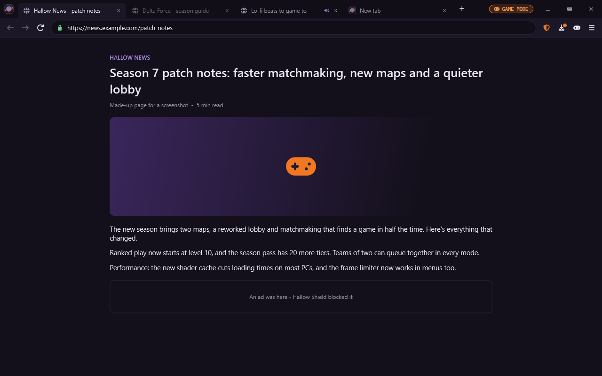
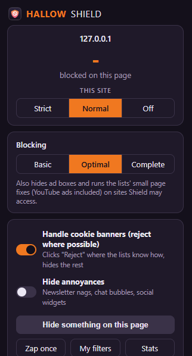

# Hallow Browser

A fast Chromium browser for gamers, in the Hallow style. **Hallow Shield is built in**, **Hallow Keys** fills your logins when you
click, and **gaming-light mode** puts background tabs to sleep while you play. It runs on **Microsoft Edge WebView2** - the Evergreen
runtime that already comes with Windows 11 - so pages render exactly like in Edge and Chrome, and the browser itself is small
(a ~300 KB app plus Microsoft's WebView2 DLLs).



Part of the Hallow family (Mixer, Hub, Vault, Overlay, Remote, Clips, Keys, Assist, Guard, Shield, Setup, Toolkit).

## Download

Get **Hallow.Browser.zip** from the [latest release](https://github.com/Dom428/hallow-browser/releases/latest), unzip it and run
**INSTALL.bat** (no admin needed). It installs to `%LOCALAPPDATA%\Programs\Hallow Browser\HallowBrowser.exe` with Start menu and
Desktop shortcuts. Or install it from [Hallow Setup](https://github.com/Dom428/hallow-setup).

Hallow Browser **never makes itself your default browser**. It registers as a browser you *can* pick, so if you want it for links,
choose it yourself in Windows Settings > Apps > Default apps.

Needs: Windows 10/11 x64 with the **Microsoft Edge WebView2 Runtime** (Windows 11 has it). If it's missing, Hallow Browser says so and
opens Microsoft's WebView2 page when you click - it never downloads the runtime itself.

## What's in 1.0

**Tabs and window**
- Tabs in the title bar: new, close (button, middle-click, Ctrl+W), drag to reorder, right-click menu (duplicate, mute, pop out video,
  put to sleep, close others), **Ctrl+Shift+T** reopens closed tabs (the last 25).
- Address bar: an address or a search - **DuckDuckGo** by default; Google, Bing or Brave Search in Settings. `javascript:` and `data:`
  are never run from the bar (they're searched). Suggestions from addresses you've used; the top one's connection is warmed up while
  you type (Settings can turn that off).
- Back / forward / reload, downloads list (Ctrl+J), find in page (Ctrl+F, F3), zoom (Ctrl +/-/0, Ctrl+wheel; a zoom chip shows when
  it isn't 100%), print, fullscreen video (and F11), links that open new windows open new tabs (sign-in pop-ups keep working).
- Keyboard shortcuts like Chrome: Ctrl+T / N / W / Shift+T / Tab / Shift+Tab / PgUp / PgDn / 1-8 / 9 / L / K / R / Shift+R / F / G / J / P / , ,
  Alt+Left / Right / D / Home, F5, F6, F11, F12, Esc, Ctrl+Shift+M (mute), Ctrl+Shift+Del (clear data).
- **Session restore**: the tabs from last time come back; background tabs load when you click them (fast start).
- **Dark pages**: pages get `prefers-color-scheme: dark` where they support it (Settings: dark / like Windows / light).

**Hallow look**: the "Hallow console" style - dark purple-black chrome, the Hallow accent from `%APPDATA%\Hallow\theme.json` (live)
and lilac secondaries. Every colour of the browser's own UI is a theme resource (src\Theme.xaml), ready for the family's light mode.

**Hallow Shield, built in** - see [what works inside WebView2](#hallow-shield-inside-webview2). It can't be removed or switched off as
an extension, but everything in it can be set: levels, per-site Strict / Normal / Off and Pause, cookie banners, annoyances, the lists,
My filters, the zapper and stats - Shield's own popup (the shield button) and settings page (Menu > Hallow Shield settings).

**Hallow Keys autofill** - a key appears in the address bar when Hallow Keys has a login for the page; nothing is filled until you click
it and pick a login. See [Hallow Keys](#hallow-keys).

**Speed and gaming**
- **Gaming-light mode**: while a game runs (Delta Force, Discovery, or whatever Hallow Hub says you're playing), background tabs are
  suspended, the browser's processes drop to below-normal priority and a **GAME MODE** chip shows. Tabs playing sound (and a popped-out
  video) stay awake. When the game ends, the tabs it put to sleep wake up again.
- **Tab sleeping**: background tabs you haven't looked at for 15 minutes sleep (Never / 5 / 15 / 30 / 60 min).
- **RAM limiter** (soft, off by default; 2 / 4 / 8 GB): above the cap, the least recently used background tabs sleep, then unload
  (they reload when you click them).
- **CPU limiter**: the browser always runs at below-normal priority, and background tabs ask the engine to use less memory.
- **Pop out video**: the tab moves into a small always-on-top window with its video filling it - it stays on top of games in borderless
  or windowed mode (nothing can draw over an exclusive full-screen game). "Back to tab" puts it back.
- **Hallow quick panel** (the gamepad button or the Hallow logo): game mode and the limiters, browser memory, Hallow Guard's safety
  score, Hallow Mixer, "Save a clip" (Hallow Clips) and Hallow Hub - each only when that app is running.

**Privacy**
- Third-party cookies blocked (Chromium's own setting, written to the profile before the engine starts).
- **Global Privacy Control** (`Sec-GPC: 1` and `navigator.globalPrivacyControl`) and **Do Not Track** sent.
- Microsoft's tracking prevention on Balanced (Strict in Settings). The engine's own password saving and form autofill are off
  (Hallow Keys does that).
- Clear browsing data any time, or optionally every time you close the browser.
- **Honestly:** Hallow Browser has no server and sends nothing anywhere (only GitHub, to look for updates of the browser and of Shield).
  But the page engine is **Microsoft's WebView2 runtime**, which is part of Windows and has its own diagnostic data settings
  (Windows Settings > Privacy & security > Diagnostics & feedback) and Microsoft services such as SmartScreen. That's Microsoft's
  runtime, not a Hallow server.


## Speed (measured on this PC)

Numbers from the integration test (`tests\Integration.cs`, browser off-screen, Windows 11, WebView2 runtime 158), times from the process
start:

| What | Measured |
|---|---|
| Browser UI drawn (first paint of the window) | 550-660 ms (warm profile, 14 restored tabs); ~610-770 ms on a brand-new profile |
| First page loaded (local test page) | 740-910 ms (warm), ~1.0-1.15 s (new profile) |
| New tab (pre-warmed, until drawn) | median 60-75 ms (6 tries per run; single tries 48-97 ms, one outlier 147 ms) |
| Memory | ~215-230 MB private for the whole browser after a restart with 14 tabs (13 still asleep); ~450 MB with 14 small pages all loaded (13 processes) |

How: the browser's own UI is plain WPF (no web view for the chrome); the WebView2 environment is started while the window is being built;
one hidden WebView is pre-warmed with the (fully local, no network) new-tab page and becomes the next new tab; restored tabs load only
when clicked; the JIT compiles start-up code on spare cores from a profile of the last start (`ProfileOptimization`); renderer processes
are capped at 8 (Chromium still keeps sites apart where isolation needs it); hardware acceleration stays on. No comparison with Edge's
start-up was made (it would have meant opening Edge on your screen).

## Hallow Shield inside WebView2

Shield 1.6's Chrome build ships inside the package (`shield\`, from Shield's GitHub release, sha256-checked) and is loaded with
`CoreWebView2EnvironmentOptions.AreBrowserExtensionsEnabled` + `CoreWebView2Profile.AddBrowserExtensionAsync`. Tested in the
integration test against local pages (ad hosts pointed at the test server):

| Part | Works in WebView2? |
|---|---|
| declarativeNetRequest (the blocking) | **Yes** - a test ad request (`pagead2.googlesyndication.com/pagead/...`) is blocked, normal scripts load; 10 rule sets enabled |
| Content scripts / scripting / insertCSS (cosmetic filtering) | **Yes** - 23 registered content scripts; a test ad link is hidden. On the very first start the service worker may need a moment, so the first page can miss cosmetic filtering |
| storage | **Yes** (chrome.storage.local) |
| tabs (query / get) | **Yes** |
| The popup | WebView2 has no extension toolbar, so the **Shield button** opens Shield's own `popup.html` in a small window under it, on the extension's origin. The popup asks for "the active tab", which in WebView2 would be that little window - so the browser finds the page's tab id with `chrome.tabs.query` and opens `popup.html?tab=<id>` (Shield's own parameter). Site mode, levels, switches, zapper, filters, stats work there |
| Options page | **Yes** - opens in a tab (Menu > Hallow Shield settings) |
| "Blocked on this page" count | Shows "-": `getMatchedRules` needs the optional `declarativeNetRequestFeedback` permission - same as in Chrome until you allow it |
| nativeMessaging (Shield's Hallow family bridge) | **No** - not available in WebView2. The bridge keeps working for Shield in Chrome / Edge |
| Fallback | If the runtime ever refuses the extension, Shield runs **network-only**: its plain block rules (~7,100 `||host^` / `||host/path` rules, no site conditions) through `WebResourceRequested` - no cosmetic filtering, no per-site settings. The browser says so in the Shield panel and Settings. Tested too (`HALLOW_BROWSER_FORCE_FALLBACK`) |

Updates: newer Shield versions come from Shield's own GitHub release (`hallow-shield-chrome-<v>.zip`, checked against GitHub's sha256
digest) into `%LOCALAPPDATA%\HallowBrowser\Shield\<version>` and are loaded at the next start (Settings can turn that off). A browser
update that bundles a newer Shield replaces the old one the same way.



## Hallow Keys

WebView2 has no native messaging, so the browser talks to Hallow Keys directly over the protocol Keys uses for its own browser
extension's native host: the pipe `HallowKeys.Native.<user>` (only this Windows user), one line `<session secret> <json>`, one JSON line
back; the secret is the per-session file Keys writes for this user (`%APPDATA%\HallowKeys\session.key`). Keys answers only while it's
unlocked, and decides itself which logins belong to a page (its own strict rules).

Keys' native host normally checks the *extension's identity*. Hallow Browser does the matching checks itself instead:
- the address sent to Keys is always the tab's real top-level address (from the engine, never from the page);
- a `match` only returns titles and usernames - the key shows only when Keys has logins for the page (and only on pages with a password field);
- **a fill happens only after two clicks**: the key, then a login. Never by itself, never silently;
- the origin (`scheme://host:port`) is pinned when you click the key. If the tab is on any other origin when you pick the login,
  Keys isn't even asked; the fill script checks `location.origin` again inside the page and fills only the top frame (no iframes);
- nothing from Keys is logged or kept; the password exists only in that one fill script.

Tests use a stand-in Keys on a separate test pipe with one made-up login - never the real Keys or vault.

## Family link

- Pipe `HallowFamily.Browser.<user>`: `ping`, `status`, `open` (focus), `open <url>` (http/https only), `menu` (New tab, Reopen
  closed tab, Gaming-light mode, CPU limiter), `invoke <id>`, `quit`. `HallowBrowser.exe --cmd "<line>"` for scripts.
- `%APPDATA%\HallowBrowser\status.json`: `tabs`, `asleep`, `gameMode`, `game`, `shield` (extension / fallback / missing), `shieldVersion`,
  `runtime`, `lastCrash` - never addresses, titles or history.
- Hallow Hub's generic host lists it while it runs. The Hallow accent (theme.json), crash reports (`%APPDATA%\HallowBrowser\crashes`,
  kept on this PC) and the GitHub updater (sha256-checked) work like in the other apps.

## Where things are

| What | Where |
|---|---|
| The browser | `%LOCALAPPDATA%\Programs\Hallow Browser\` (HallowBrowser.exe, Microsoft's WebView2 DLLs, `shield\`) |
| Browsing data (profile: cookies, cache, history, Shield's settings) | `%LOCALAPPDATA%\HallowBrowser\Profile` |
| Settings, open tabs, status, crash reports | `%APPDATA%\HallowBrowser` |
| Shield updates | `%LOCALAPPDATA%\HallowBrowser\Shield` |

Uninstall from Windows Settings > Apps; it asks whether to remove your browsing data too.

## Build

Nothing to install: `build.ps1` uses the C# compiler that comes with Windows (.NET Framework 4.8, C# 5).

```
.\tools\get-shield.ps1     # Shield 1.6's Chrome build into package\shield (from its GitHub release, sha256-pinned)
.\build.ps1 -Tests         # HallowBrowser.exe (x64) and tests\BrowserTests.exe
tests\BrowserTests.exe     # unit tests
tests\BrowserTests.exe --integration HallowBrowser.exe <work folder> main|fallback
```

The WebView2 SDK DLLs are in `lib\`: **Microsoft.Web.WebView2 1.0.4314.35** (NuGet), package sha256
`90778deb1b77e36292828b4b5833c9255c27533f40e0ddd55891ae718944edc4`; the package and all three DLLs are Authenticode-signed by
Microsoft Corporation. Only `Microsoft.Web.WebView2.Core.dll`, `Microsoft.Web.WebView2.Wpf.dll` (lib\net462) and
`runtimes\win-x64\native\WebView2Loader.dll` are used.

Tests: unit tests (address bar and search parsing, origins and the Keys fill rules, game mode / tab sleeping / RAM limiter decisions,
settings, Shield's fallback rules and update picking, the theme, the family pipe, the Keys protocol against a stand-in); integration
tests drive the real browser off-screen (never shown, never focused) with its own test profile and pipes, against local pages from a
tiny server: Shield blocking and cosmetic filtering, Shield's popup and options page, third-party cookies (and a control run with the
setting off), GPC/DNT headers, dark pages, Keys filling only after the click and refusing an origin change, game mode with a fake game
(suspended tabs, awake audio tab, priority), close / reopen, pop-out, find, zoom, downloads (to the test folder), the family pipe, speed
and memory, session restore. Page pictures come from `CapturePreviewAsync`, the browser UI from `HallowBrowser.exe --snap <folder>`.

## Credits

- **Microsoft Edge WebView2** SDK (Microsoft.Web.WebView2 1.0.4314.35), (c) Microsoft Corporation, BSD-style licence - redistributed
  as it allows (`WebView2-LICENSE.txt`, `WebView2-NOTICE.txt`). The WebView2 runtime itself is Microsoft's and isn't shipped.
- **Hallow Shield** (Dom428/hallow-shield) and its filter lists (uBlock Origin's lists, EasyList, EasyPrivacy and others - see
  `shield\LISTS-LICENSE.txt`).
- Icons: **Font Awesome Free** 7.3.1 (CC BY 4.0, `FontAwesome-LICENSE.txt`).
